# 01 — NGINX + Fail2Ban + UFW: Intrusion Detection & Automated Response

**Focus:** Network/host defence, log-based detection, automated response  
**Tools:** NGINX, Fail2Ban (custom filter and jails), UFW/iptables, curl, systemd, Ubuntu, Kali Linux (VirtualBox)

## Objective
Build a web server that detects abusive HTTP behaviour from its own access logs and automatically blocks the offending IP at the firewall, then verify the whole ban / unban lifecycle.

## Environment
| Build | Server | Attacker |
|---|---|---|
| Build 1 | Kali Linux, 192.168.0.106 | Ubuntu, 192.168.0.150 |
| Build 2 (roles reversed) | Ubuntu, 192.168.47.5 | Kali Linux, 192.168.47.6 |

Running the lab from both directions meant configuring and verifying the stack on two different distributions.

## What I did
**Build 1 — baseline IPS**
1. Confirmed NGINX was active and listening on port 80 (`systemctl`, `ss -tulpn`, local `curl`).
2. Configured `/etc/fail2ban/jail.local` with three jails: `sshd`, `nginx-http-auth`, `nginx-botsearch`.
3. Simulated scanning from the client with repeated `curl` requests to `/wp-login.php`, `/admin` and `/phpmyadmin`, producing a flood of 404s.
4. `nginx-botsearch` crossed `maxretry = 3` (17 failed attempts counted in total) and banned the client via iptables.
5. Verified the ban, then unbanned with `fail2ban-client set nginx-botsearch unbanip`.

**Build 2 — custom detection logic**
1. Wrote my own filter, `/etc/fail2ban/filter.d/nginx-req-abuse.conf`, matching GET/POST/HEAD requests that return 400/403/404/444/499 in the NGINX access log, instead of relying only on the stock filters.
2. Added an `[nginx-req-abuse]` jail to `jail.local` (initial `maxretry = 10`, `findtime = 60`, `bantime = 1h`) on top of defaults of `bantime = 1h`, `findtime = 10m`, `maxretry = 5`, with `ignoreip = 127.0.0.1/8 ::1`.
3. Validated the configuration with `fail2ban-client -t`, restarted the service and checked all four loaded jails.
4. Ran a controlled attack from Kali: five `curl` requests, one second apart, to a non-existent path.
5. Confirmed enforcement **at the firewall**, not just in Fail2Ban's own status: `ufw status numbered` showed `REJECT IN 192.168.47.6 # by Fail2Ban after 5 attempts against nginx-req-abuse`.
6. Read `/var/log/fail2ban.log` to follow the full cycle: **Ban → Unban → Restore Ban → Unban → Restore Ban**.
7. Used `curl -w "%{http_code}"` from the attacker to show that requests returned `000` (no connection) while the IP was banned.

## Results
- Automated detection and blocking worked end to end on both builds.
- Enforcement was verified at three layers: Fail2Ban jail status, UFW rule, and attacker-side connection failure.

## Troubleshooting and observations
- A filename typo (`nginx-req-abusee.conf`) was caught and corrected while saving the filter.
- Some `fail2ban-client get ... banaction/action` queries returned errors (`Invalid command`, `IndexError`); I used the log and UFW state as the source of truth instead.
- `fail2ban-client -t` warned `No actions were defined` for the nginx jails; bans still landed in UFW through the default ban action.
- The UFW ban comment cites 5 attempts while the jail was first configured with `maxretry = 10`, so the threshold was tuned during testing.

## Limits and what I would improve
- A 404/403-based filter can ban legitimate users with broken links; in production I would raise thresholds, add `ignoreip` for trusted ranges, and review bans.
- Per-IP banning does not stop a distributed attack; layered detection is covered in projects 07 and 08.

## Evidence
**01. Initial jail.local: [DEFAULT] plus nginx-http-auth and nginx-botsearch jails**  
![Initial jail.local: [DEFAULT] plus nginx-http-auth and nginx-botsearch jails](screenshots/01-jail-local-initial.png)

**02. NGINX service active and serving the default page**  
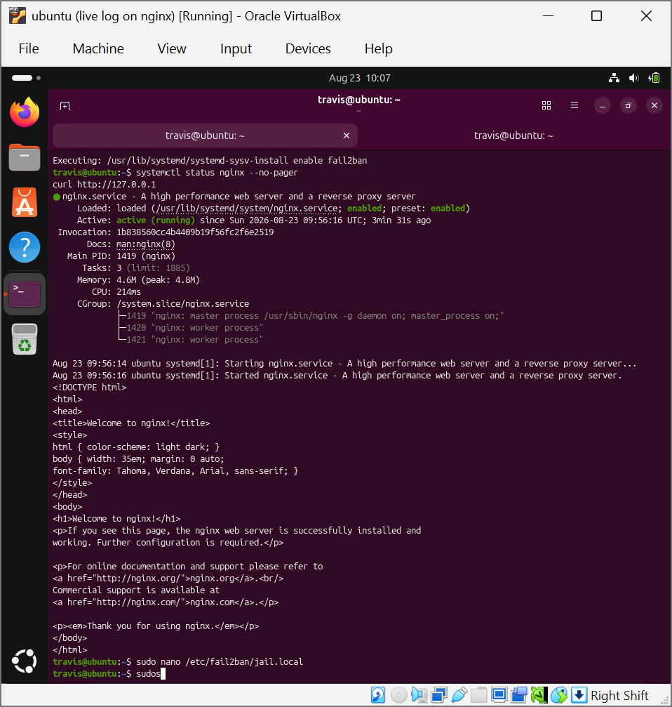

**03. Authoring the custom filter nginx-req-abuse.conf (failregex for 400/403/404/444/499 responses)**  
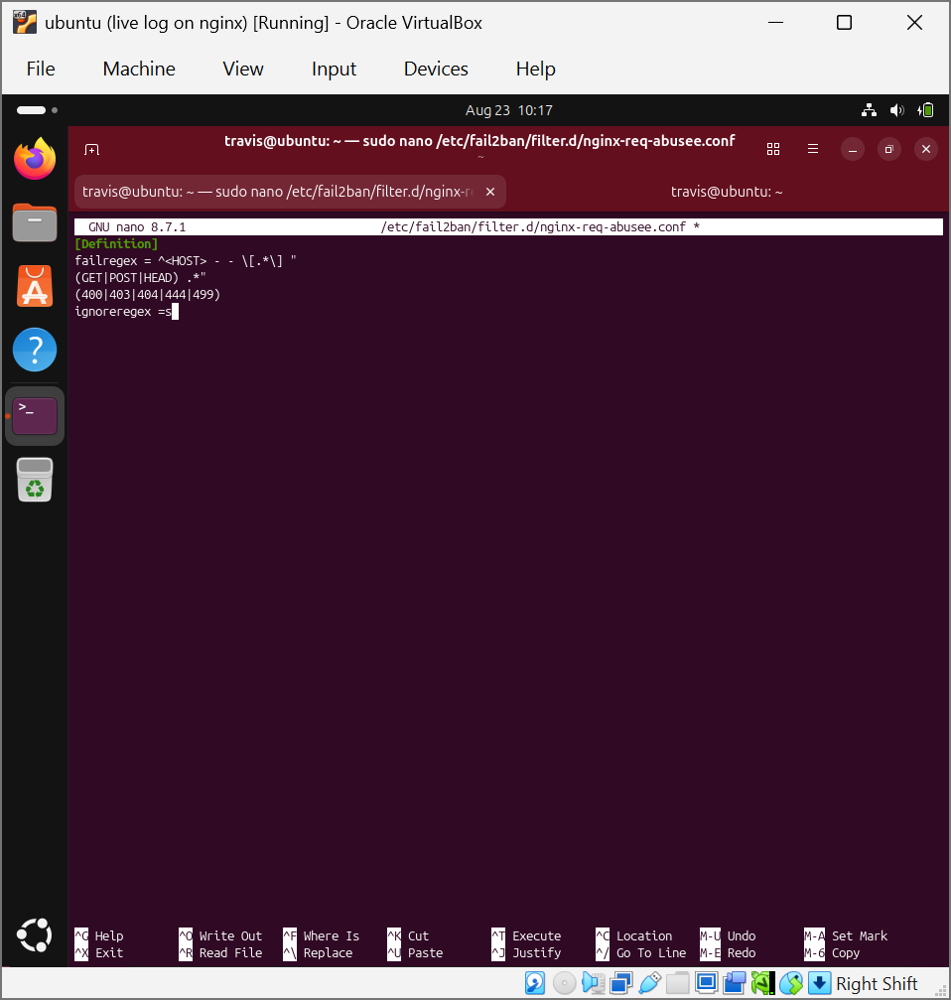

**04. Saving the corrected filter file**  
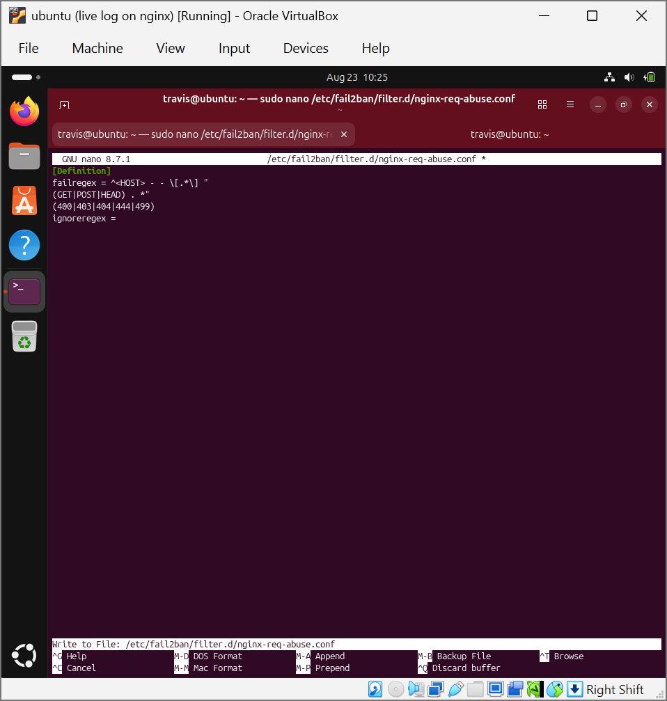

**05. jail.local extended with the nginx-req-abuse jail (maxretry 10, findtime 60, bantime 1h)**  
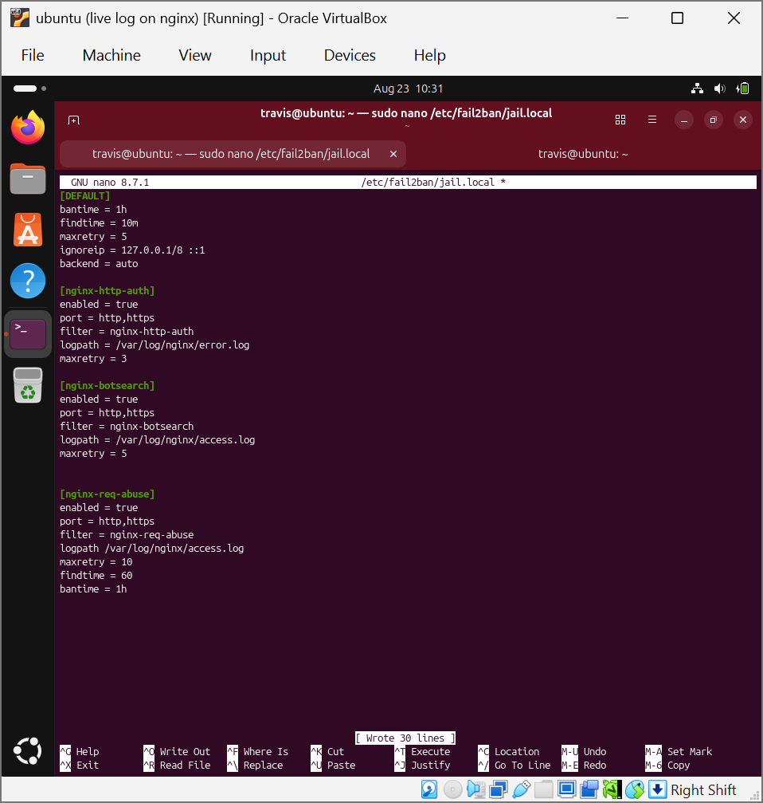

**06. fail2ban-client -t config test, service restart and jail status**  
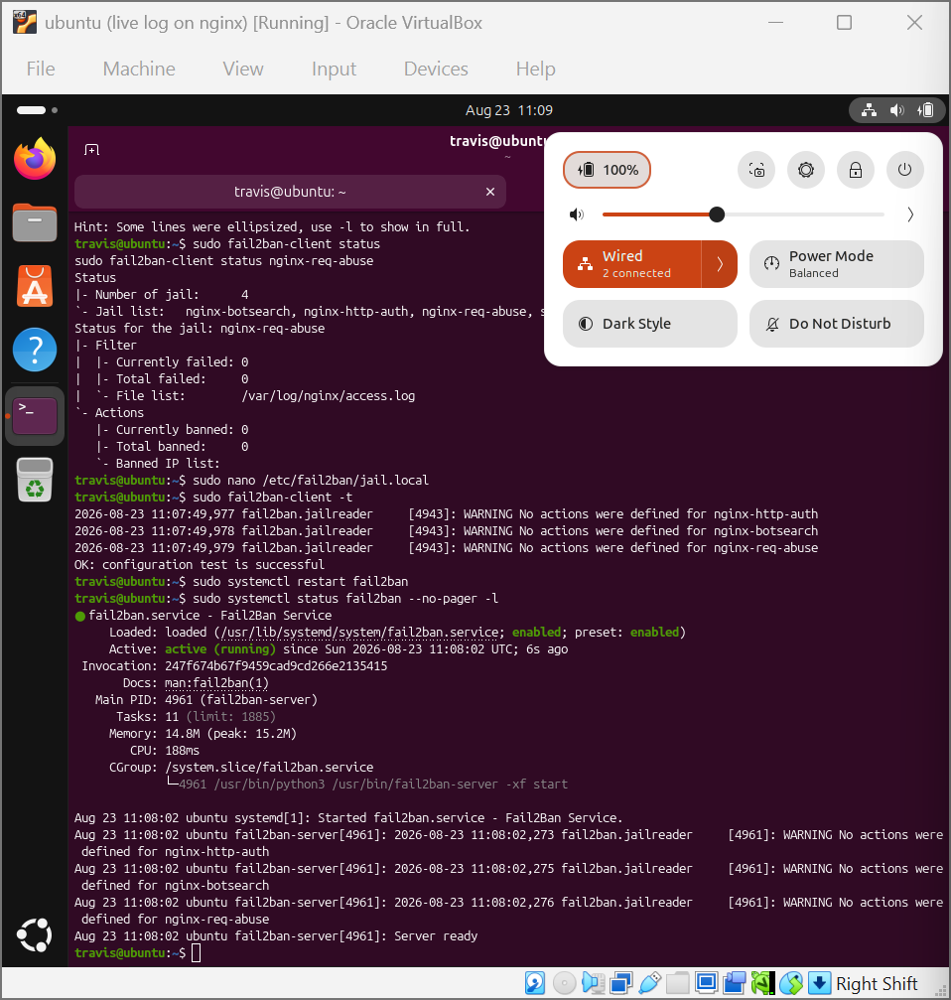

**07. Four jails loaded, per-jail status before the attack**  
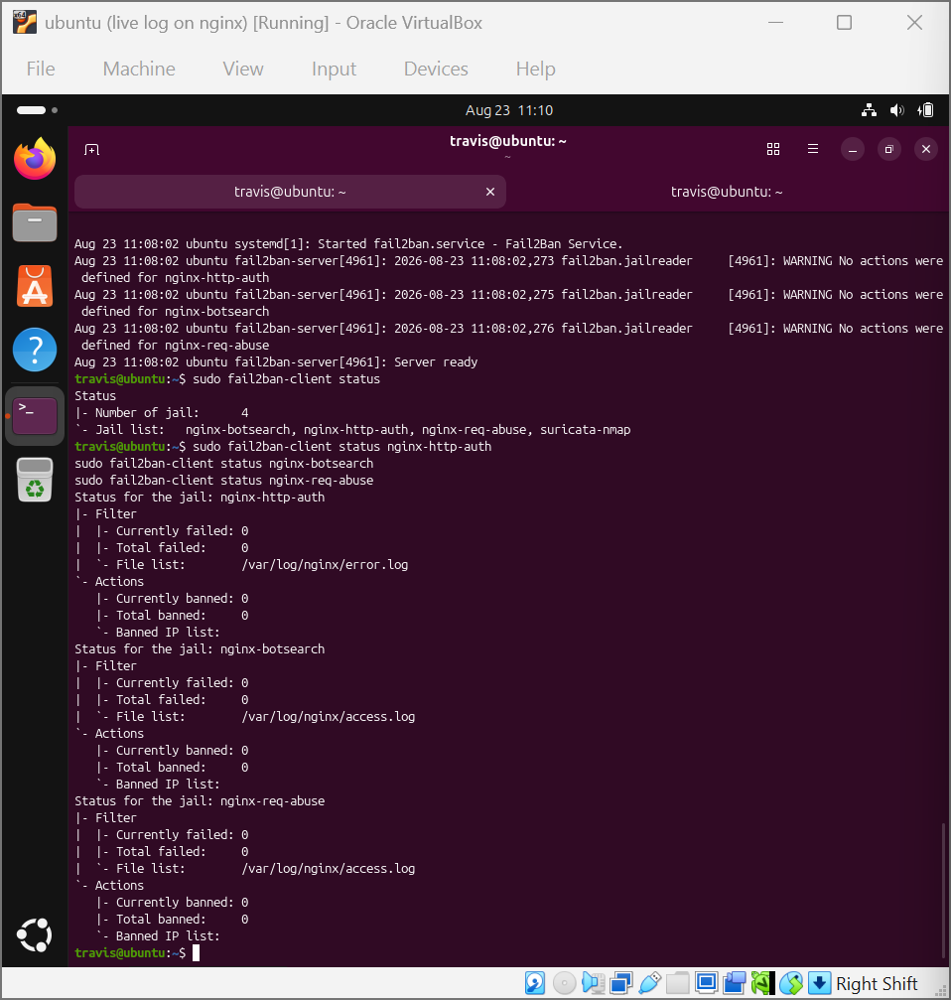

**08. Jail status after the attack: failures counted and attacker IP banned**  
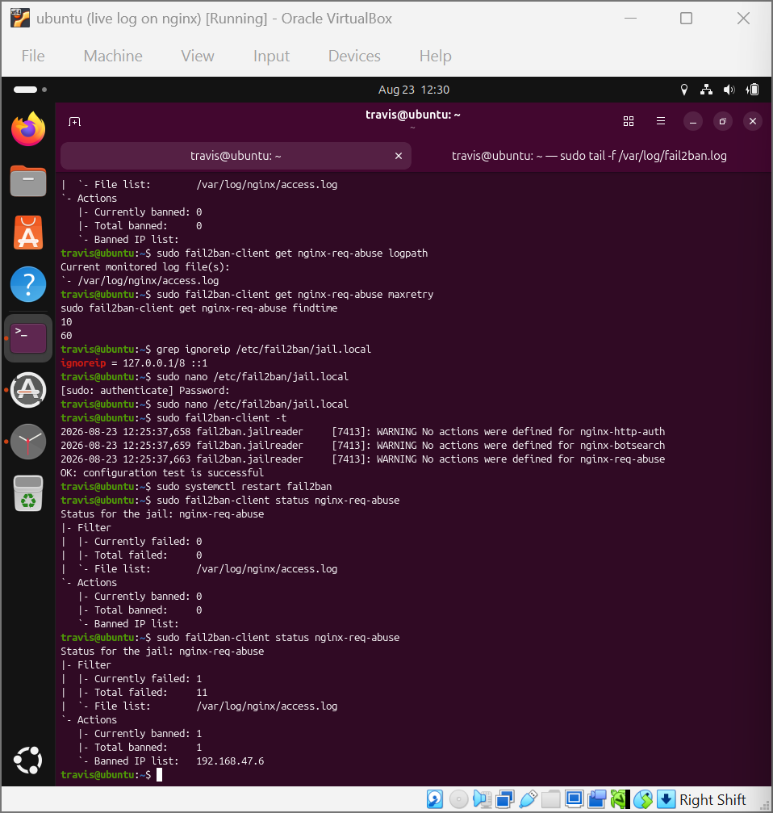

**09. UFW REJECT rule created by Fail2Ban, plus Ban / Unban / Restore Ban entries in fail2ban.log**  
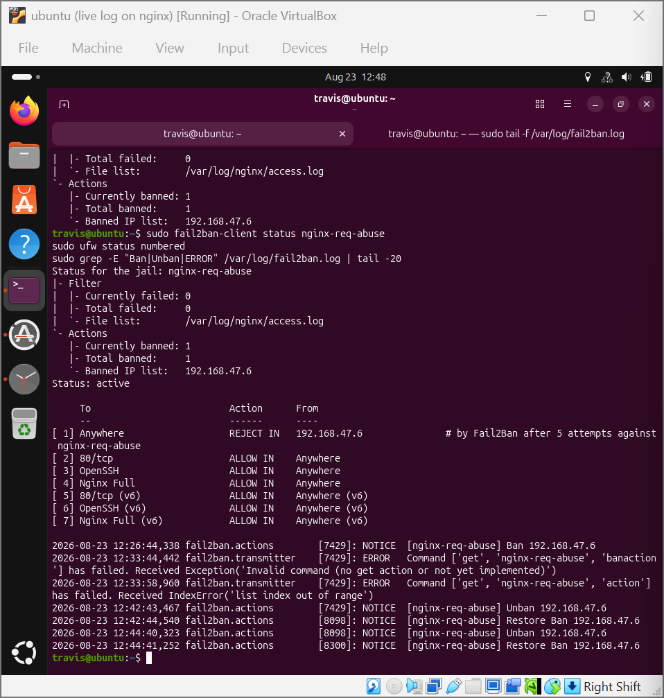

**10. Attacker (Kali): 5 curl requests to a non-existent path, 1 second apart**  
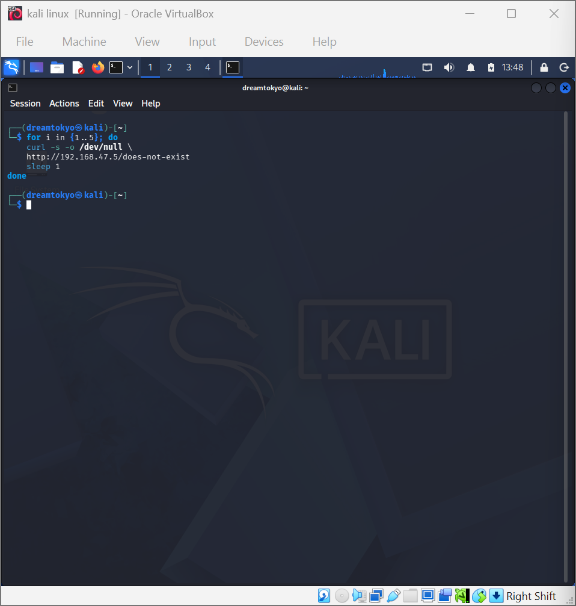

**11. UFW rule, jail status and manual unban with fail2ban-client set ... unbanip**  
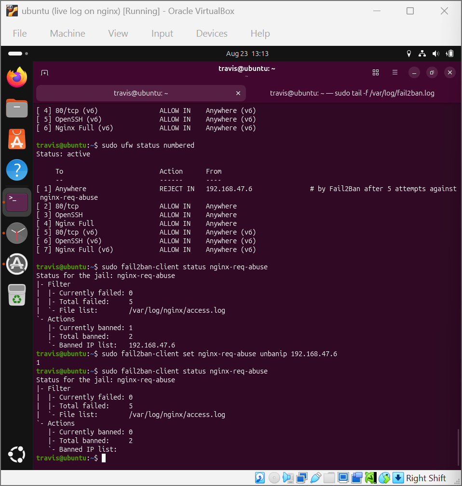

**12. Attacker curl with %{http_code} returning 000 while banned**  
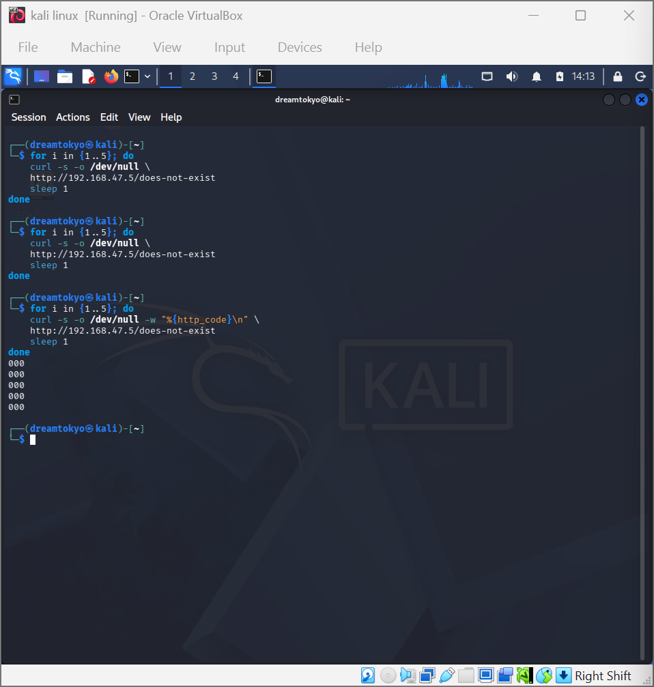
