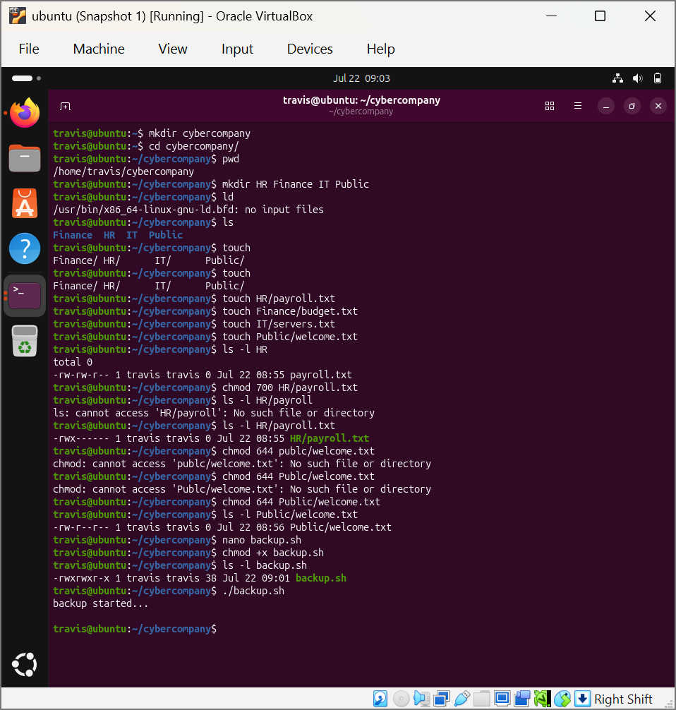
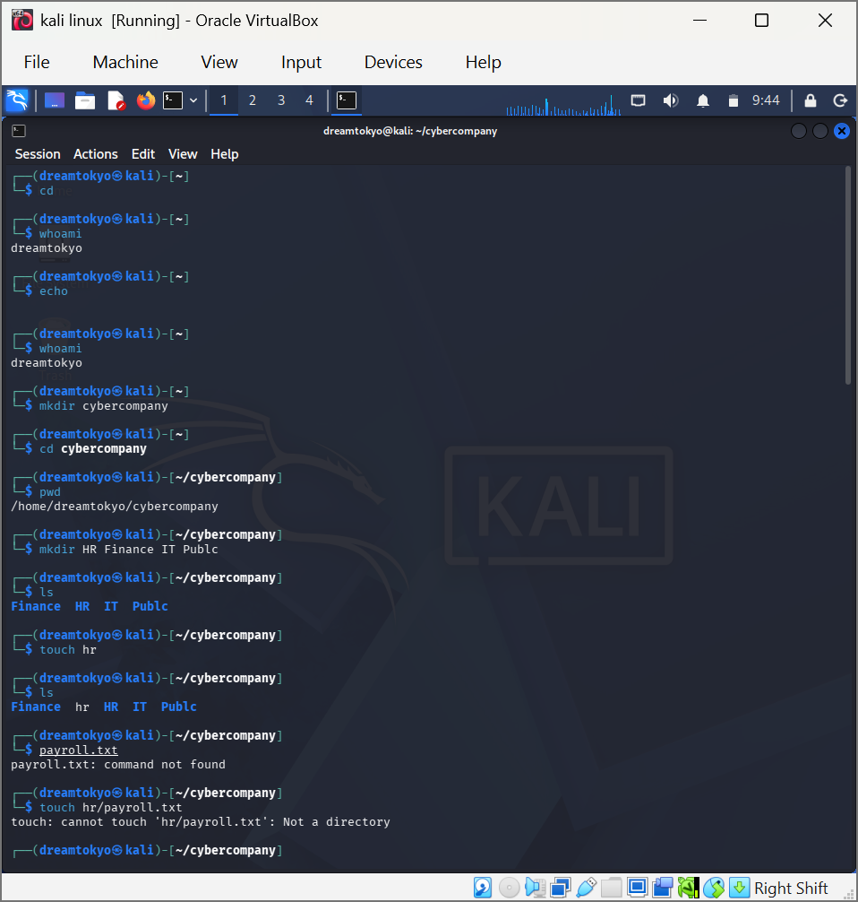
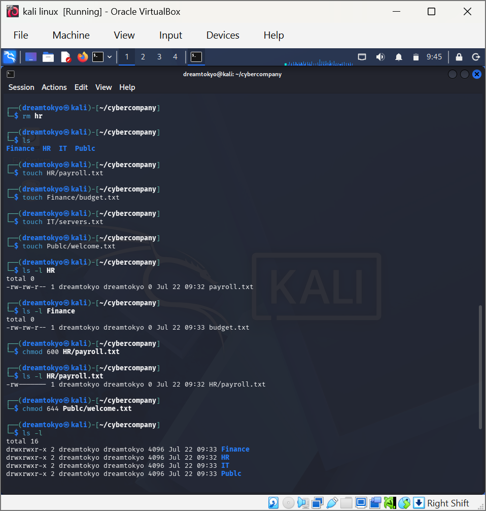
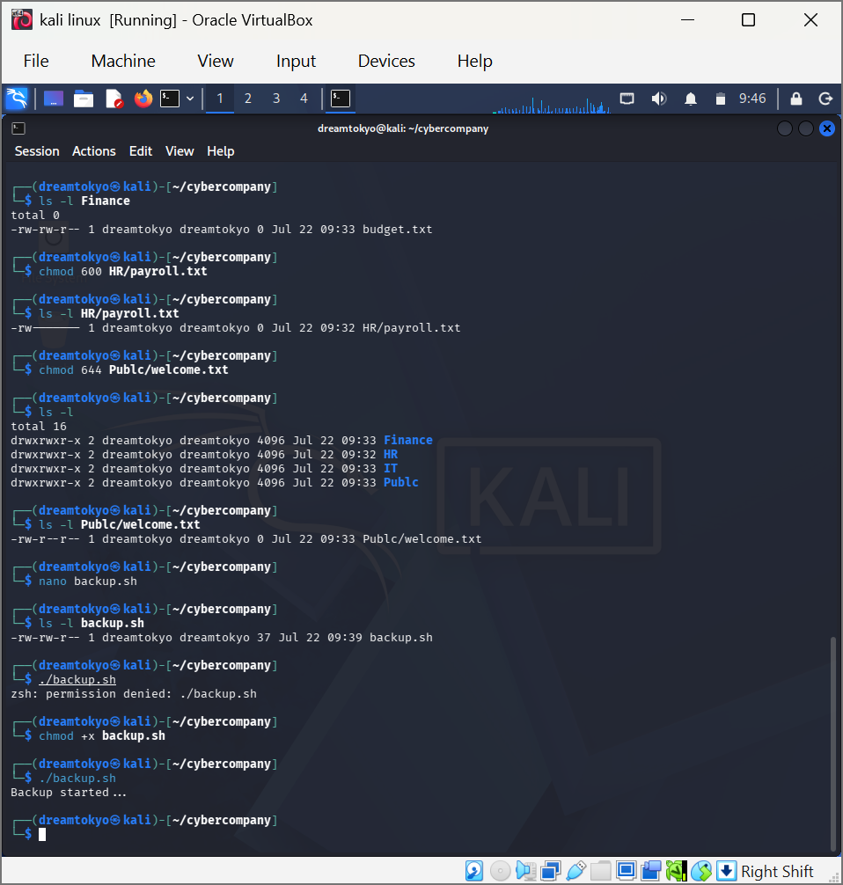

# 03 — Linux File Permissions & Departmental Directory Structure

**Focus:** Linux fundamentals, access control, shell scripting  
**Tools:** Bash, mkdir, touch, chmod, ls -l, nano — Ubuntu and Kali Linux (VirtualBox)

## Objective
Model a small company's file structure and apply permissions according to data sensitivity.

## What I did
1. Created `cybercompany/` with `HR`, `Finance`, `IT` and `Public` departments and one file in each.
2. Applied permissions by sensitivity: owner-only on `HR/payroll.txt` (`chmod 700` on the Ubuntu run, `600` on the Kali run) and world-readable `644` on `Public/welcome.txt`.
3. Verified every change with `ls -l`.
4. Wrote `backup.sh` with nano, hit `permission denied`, fixed it with `chmod +x` and ran it successfully.
5. Repeated the whole exercise on a second distribution (Kali) as a fresh run.

## Errors I hit and fixed
- A typo in a directory name (`Publc`) produced `No such file or directory`; corrected the path.
- `touch hr/payroll.txt` failed because `hr` had been created as a file, not a directory; removed it and used the right directory.
- The script would not run until it had the execute bit.

## Takeaways
- A plain data file such as `payroll.txt` does not need the execute bit, so `600` is the more appropriate mode than `700`.
- Everything here is owner-based. A real HR team would need group permissions or ACLs, which this lab does not cover.

## Evidence
**01. Ubuntu run: directory tree, chmod 700/644, backup.sh made executable and run**  

**02. Kali run: structure creation and path/file-vs-directory errors**  

**03. Kali run: files created, chmod 600/644, ls -l verification**  

**04. Kali run: permission denied on backup.sh, fixed with chmod +x**  

