# 04 — Cisco Port Security: Sticky vs. Manual MAC

**Focus:** Layer 2 security  
**Tools:** Cisco Packet Tracer, Cisco IOS CLI

## Objective
Compare two port-security strategies side by side on identical segments and observe how each violation mode behaves.

## Design
| | Segment A | Segment B |
|---|---|---|
| MAC assignment | Sticky (learned dynamically) | Manual (static MAC per port) |
| Violation mode | `restrict` | `shutdown` |
| Ports | Fa0/1–Fa0/4 | Fa0/1–Fa0/4 |

## What I did
**Segment A — sticky / restrict**
- Configured Fa0/1–4 as access ports with `switchport port-security`, `maximum 1`, `mac-address sticky`, `violation restrict` (a mistyped `switchport-security` was rejected and corrected).
- Verified with `show port-security` and per-interface detail: one sticky MAC learned per port, 0 violations.
- Triggered violations by presenting different MAC addresses on protected ports. Syslog showed `%PORT_SECURITY-2-PSECURE_VIOLATION`, the violation counter climbed (4 on the affected ports), the port stayed up and traffic from the offending MAC was dropped.
- A ping that had worked then timed out 100%, showing the practical effect of the violation.

**Segment B — manual / shutdown**
- Looked up each host's MAC and bound it statically per port (`mac-address <MAC>`), with `violation shutdown`, then saved the configuration.

## Why it matters
- `restrict` keeps the port up and logs/drops the offending traffic: good for availability, but the offender keeps trying.
- `shutdown` disables the port on violation: stricter, but a single spoofed MAC can take a legitimate device offline until someone re-enables the port.
- Sticky is easier to deploy; manual binding is tighter but does not scale.
- MAC-based port security can be bypassed by MAC spoofing, so it is one layer, not a complete control.

## Limits
This lab documents violation testing on the sticky segment. The manual segment is configured and saved; its violation behaviour is not demonstrated in these screenshots.

## Evidence
**01. Two segments: sticky-MAC (PC0-PC3) and manual-MAC (PC4-PC7), both 192.168.1.0/24**  
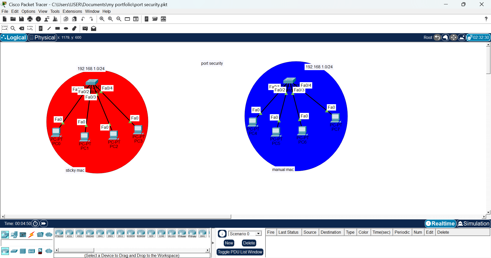

**02. Sticky config on Fa0/1-4 (with a corrected syntax error) and show port-security**  
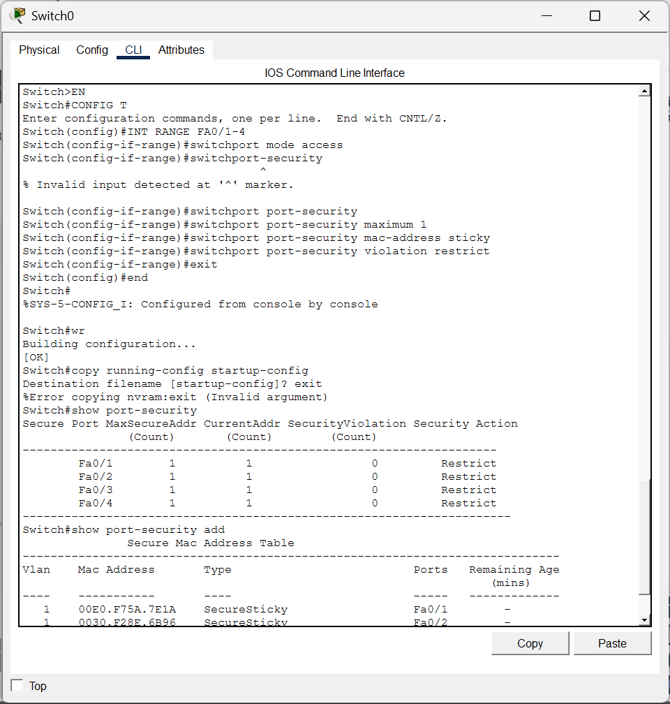

**03. Per-interface detail for Fa0/1 and Fa0/2: sticky MAC learned, 0 violations**  
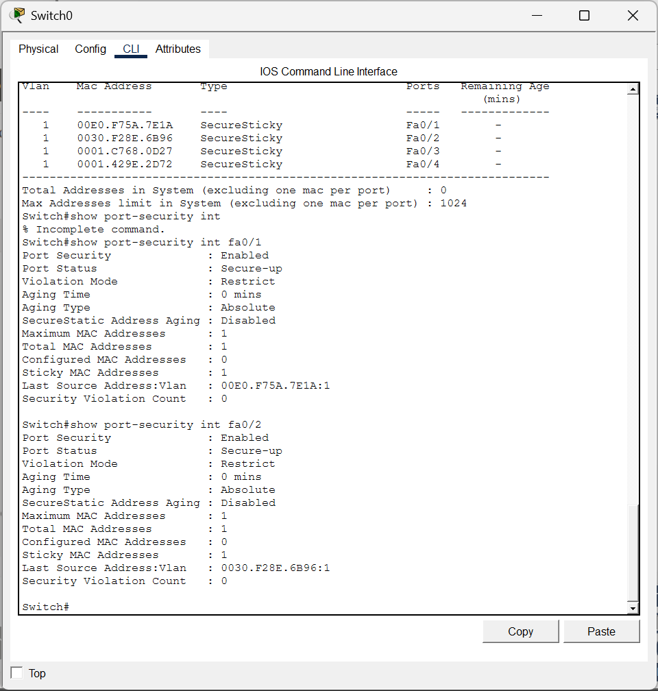

**04. Per-interface detail for Fa0/3 and Fa0/4**  
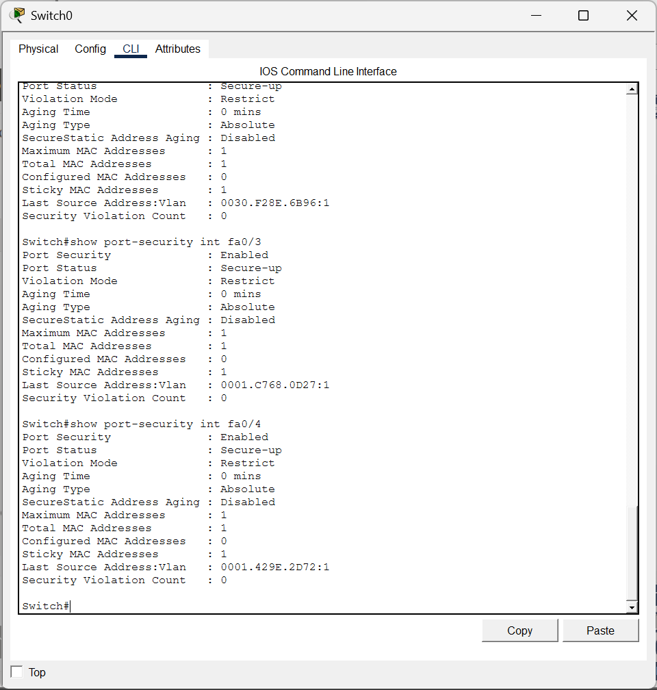

**05. Ping succeeds, then times out 100% after the port-security change**  
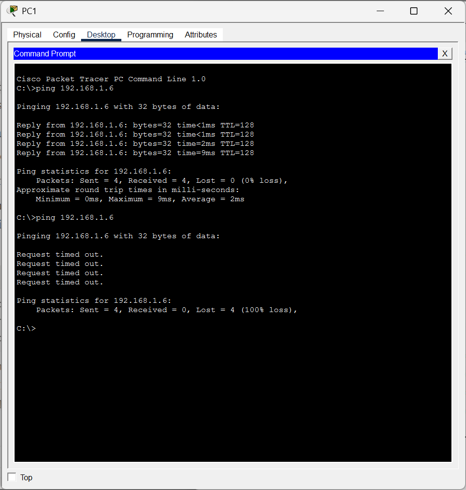

**06. PSECURE_VIOLATION syslog on Fa0/1; violation count 4 in restrict mode**  
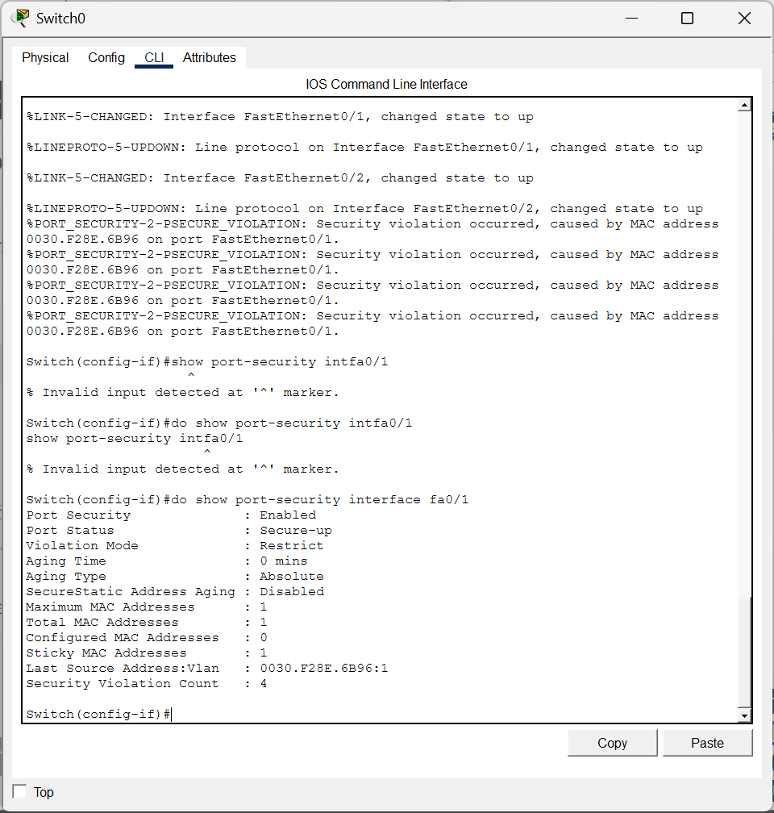

**07. Link up/down events correlated with violations on Fa0/2**  
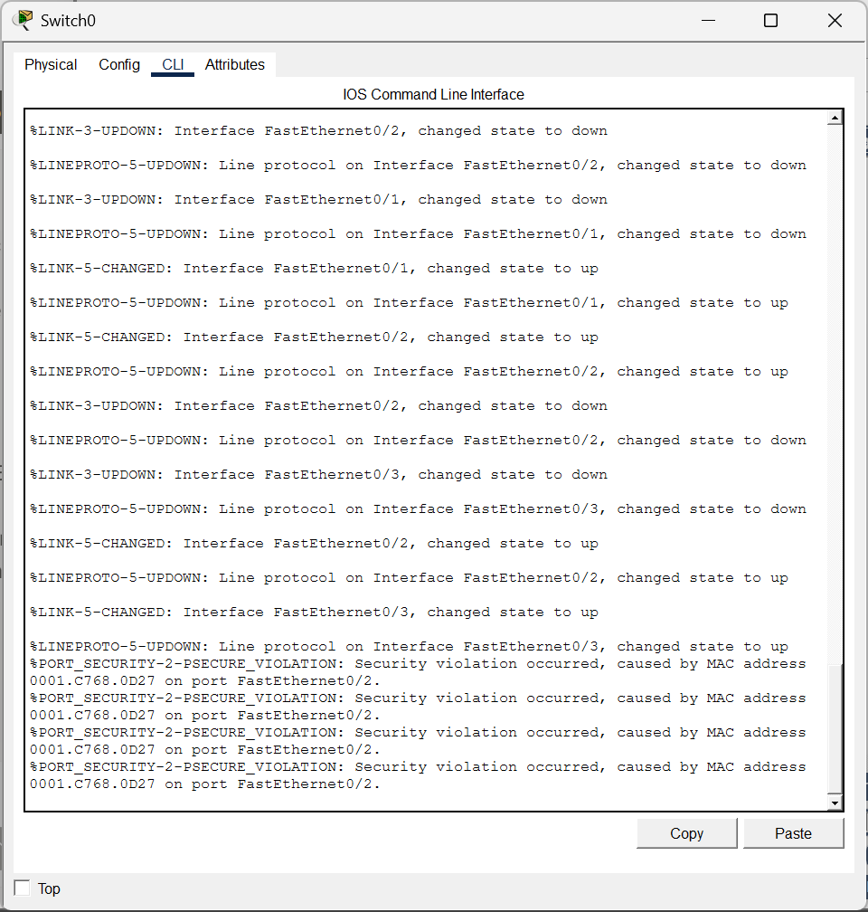

**08. Violation count 4 on Fa0/2; port stays secure-up (restrict mode)**  
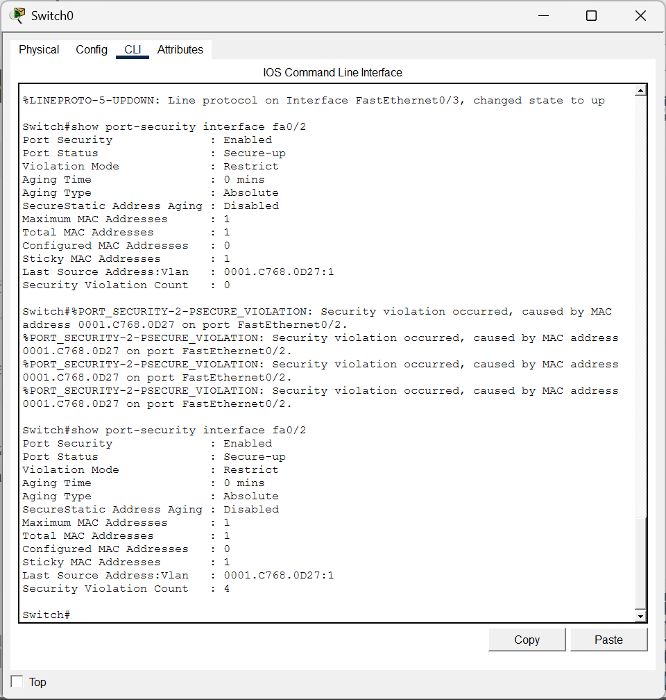

**09. Host MAC/IP lookup used for the manual MAC binding (0006.2AD2.D149)**  
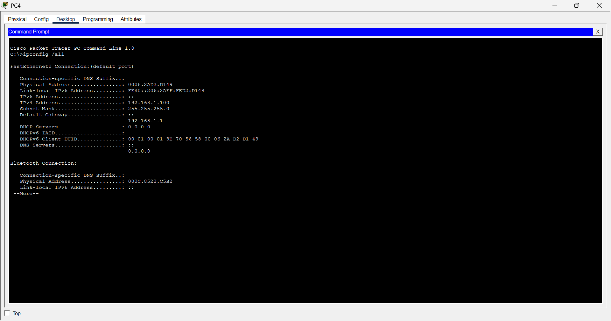

**10. Second host MAC/IP lookup (0010.1159.8062)**  
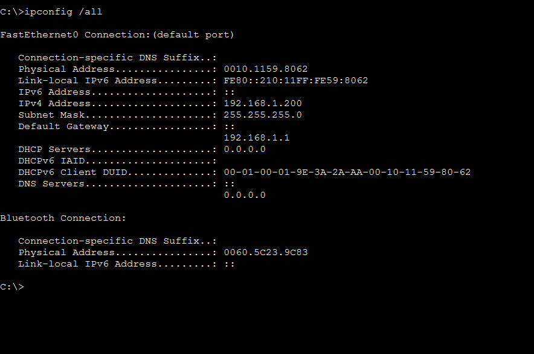

**11. Manual-MAC segment: static MAC per port with violation shutdown**  
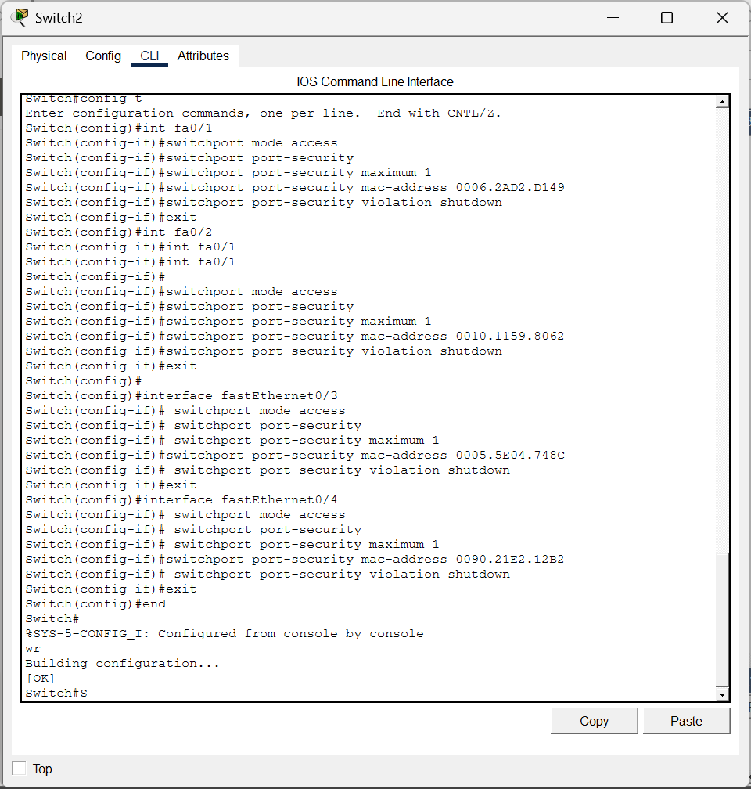
