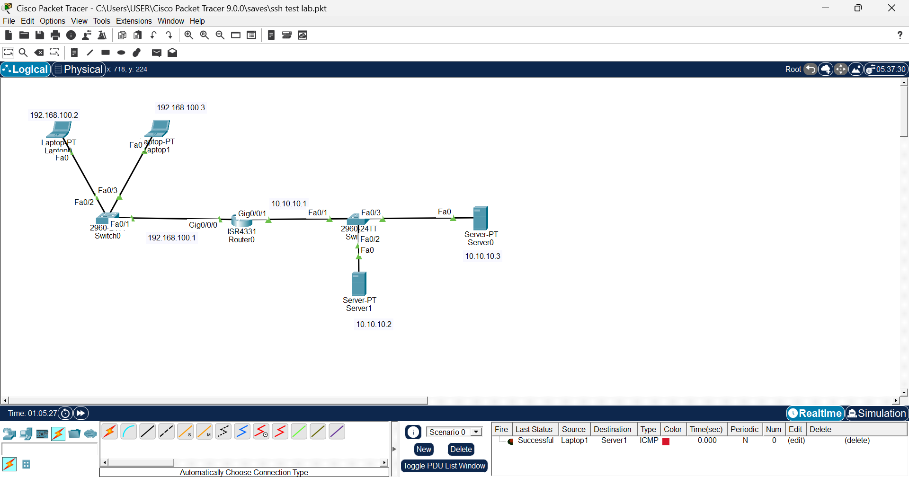
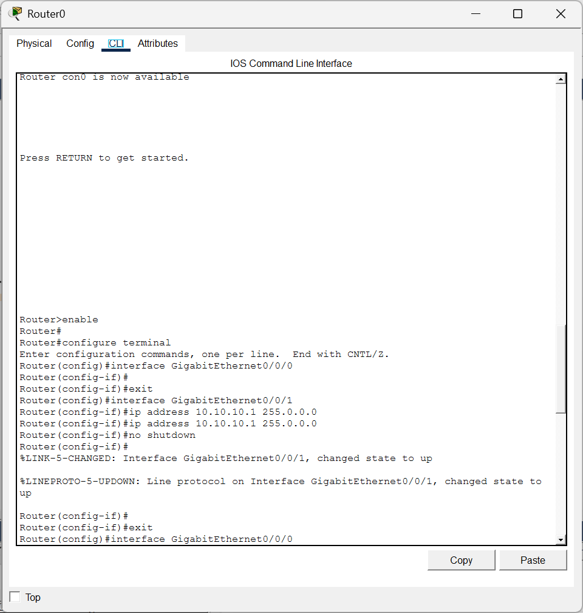
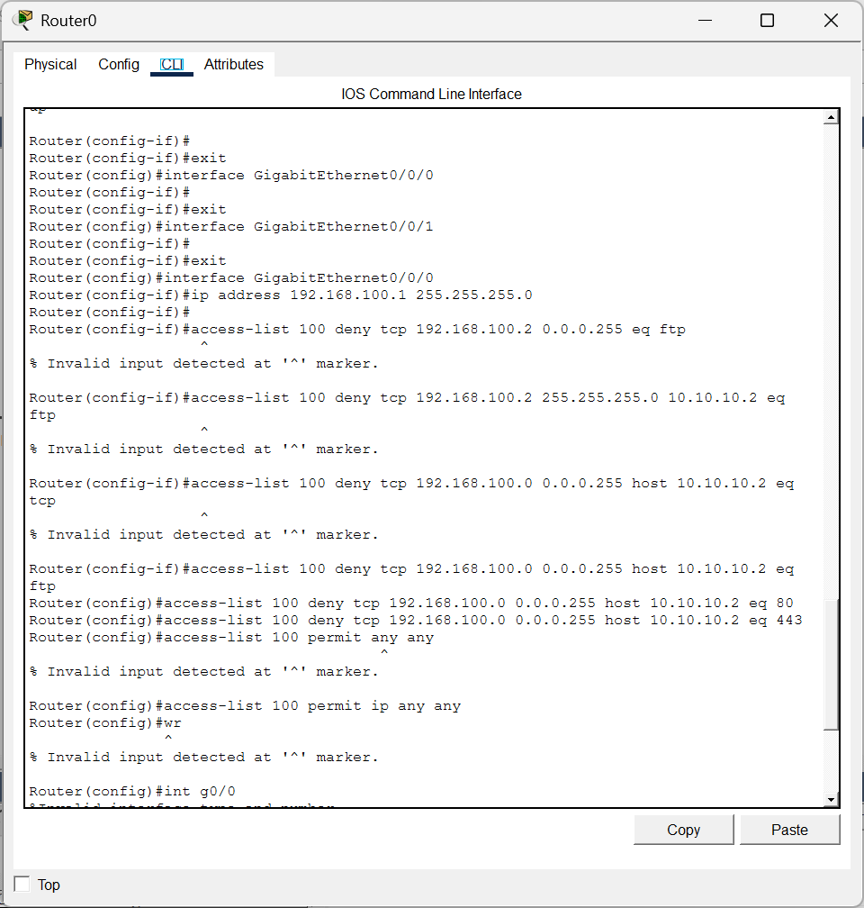
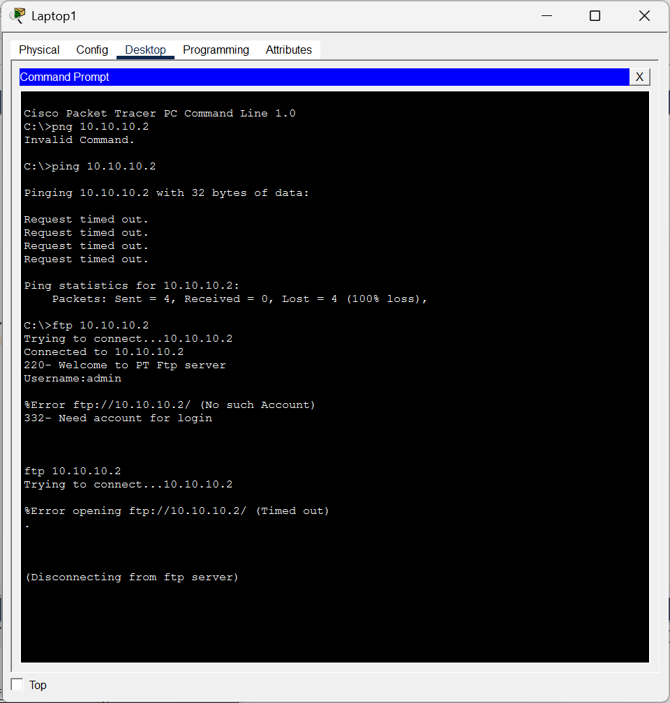
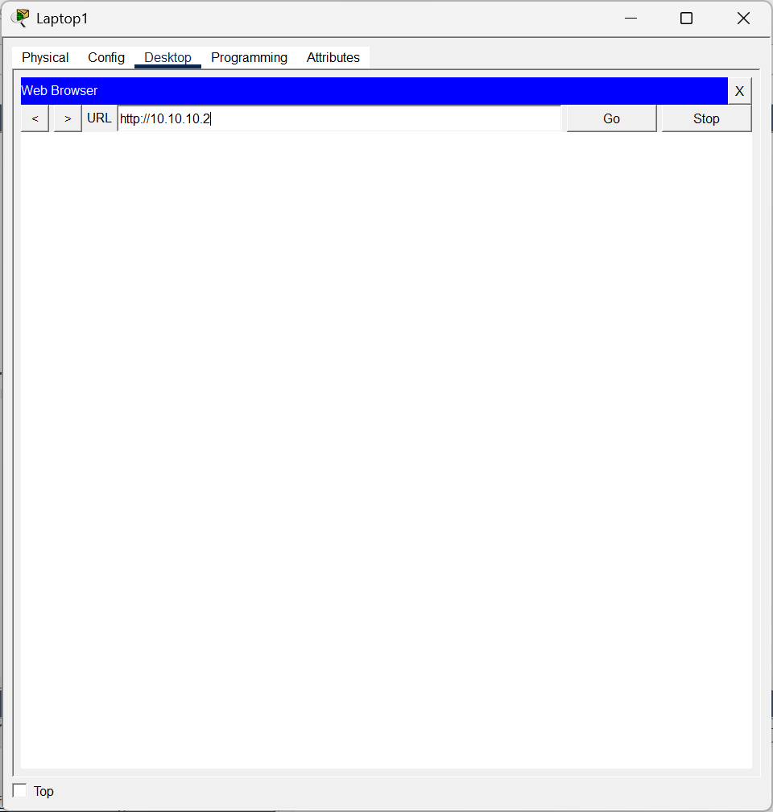
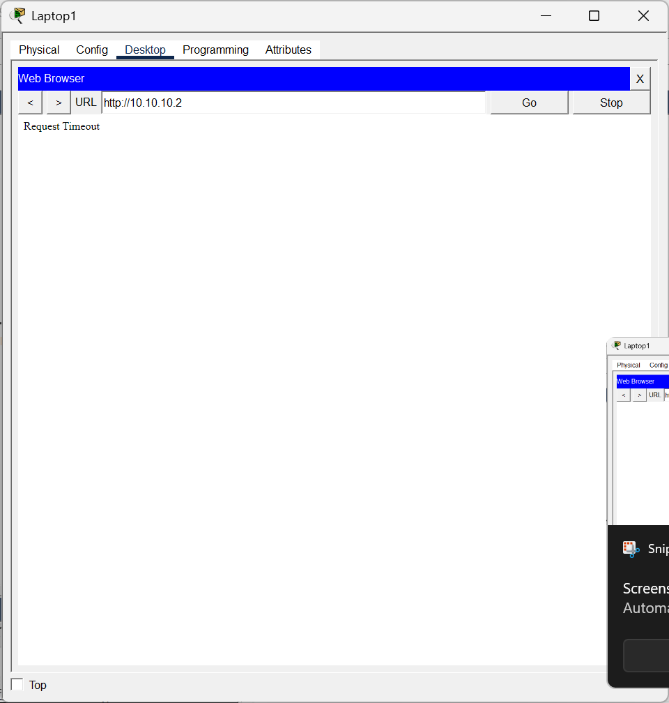
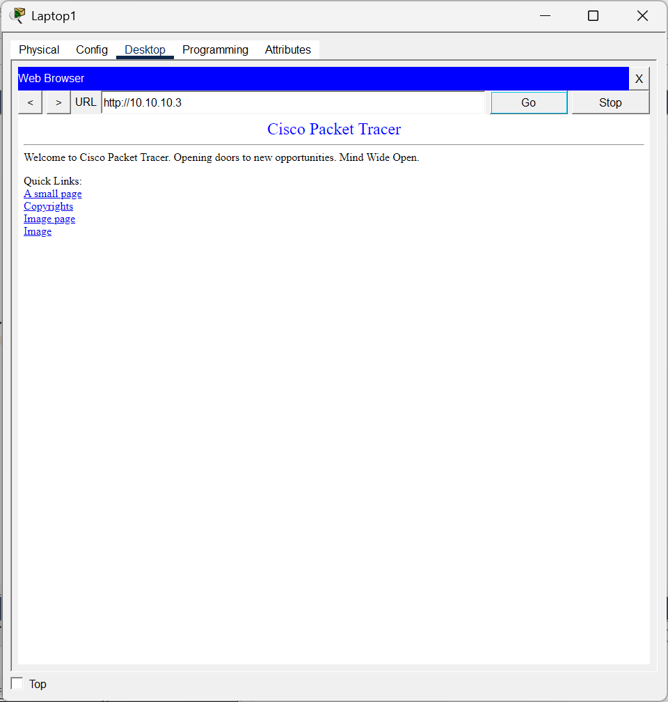

# 05 — Cisco Extended ACL: Selective Service Filtering

**Focus:** Access control, traffic filtering  
**Tools:** Cisco Packet Tracer, Cisco IOS extended ACLs

## Objective
Block FTP, HTTP and HTTPS from a client subnet to one specific server while leaving a second server reachable.

## Topology
Clients `192.168.100.0/24` → switch → router (Gig0/0/0 = 192.168.100.1, Gig0/0/1 = 10.10.10.1/24) → switch → Server1 `10.10.10.2` and Server0 `10.10.10.3`. Static addressing.

## What I did
1. Configured the router interfaces.
2. Built extended ACL 100 after several rejected attempts at the syntax (mixing subnet masks and wildcard masks, wrong host/port forms):
   - `access-list 100 deny tcp 192.168.100.0 0.0.0.255 host 10.10.10.2 eq ftp`
   - `access-list 100 deny tcp 192.168.100.0 0.0.0.255 host 10.10.10.2 eq 80`
   - `access-list 100 deny tcp 192.168.100.0 0.0.0.255 host 10.10.10.2 eq 443`
   - `access-list 100 permit ip any any` (an initial `permit any any` was rejected)
3. Applied the ACL to the client-facing interface.
4. Tested from a client:
   - `http://10.10.10.2` → **Request Timeout** (denied)
   - `http://10.10.10.3` → **page loads** (not covered by the deny rules)
   - FTP to `10.10.10.2` timed out once the ACL was active.

## Takeaways
- A wildcard mask is the inverse of a subnet mask (0 = must match, 1 = don't care), which is where most of my errors came from.
- The final `permit ip any any` matters: ACLs end with an implicit deny.
- Always test a filter from the client side; a saved config proves nothing by itself.

## Note
In an early router screenshot the server-side interface mask was typed as `255.0.0.0`; the intended mask was `255.255.255.0`.

## Evidence
**01. Topology: clients on 192.168.100.0/24, router, servers on 10.10.10.0/24**  

**02. Router interface configuration**  

**03. ACL 100 built after several rejected syntax attempts; permit ip any any added**  

**04. Client tests: ping timeout and FTP behaviour against 10.10.10.2**  

**05. HTTP test to the filtered server**  

**06. Request timeout to 10.10.10.2 (HTTP denied by ACL)**  

**07. Page loads from 10.10.10.3 (not covered by the deny rules)**  

