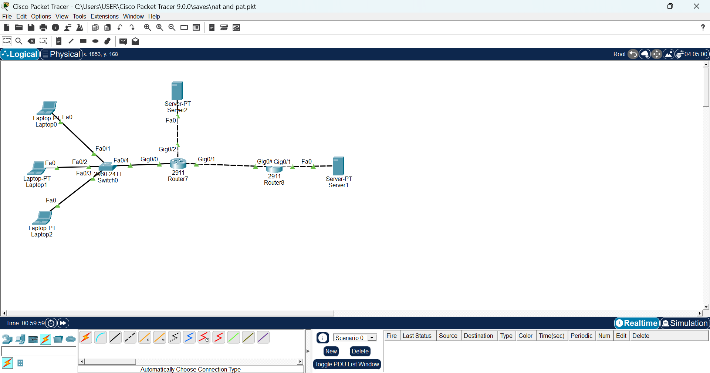
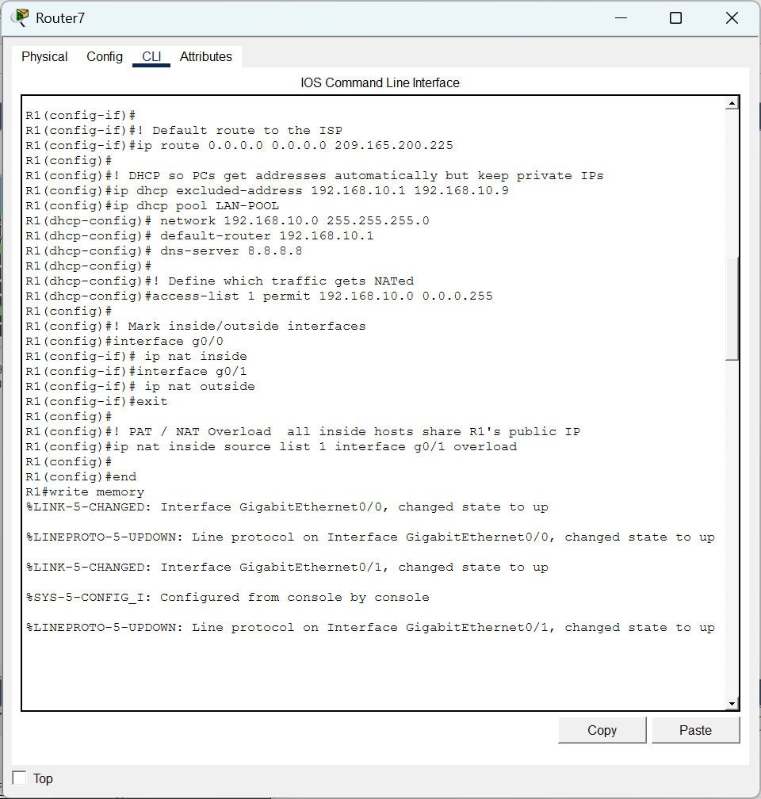
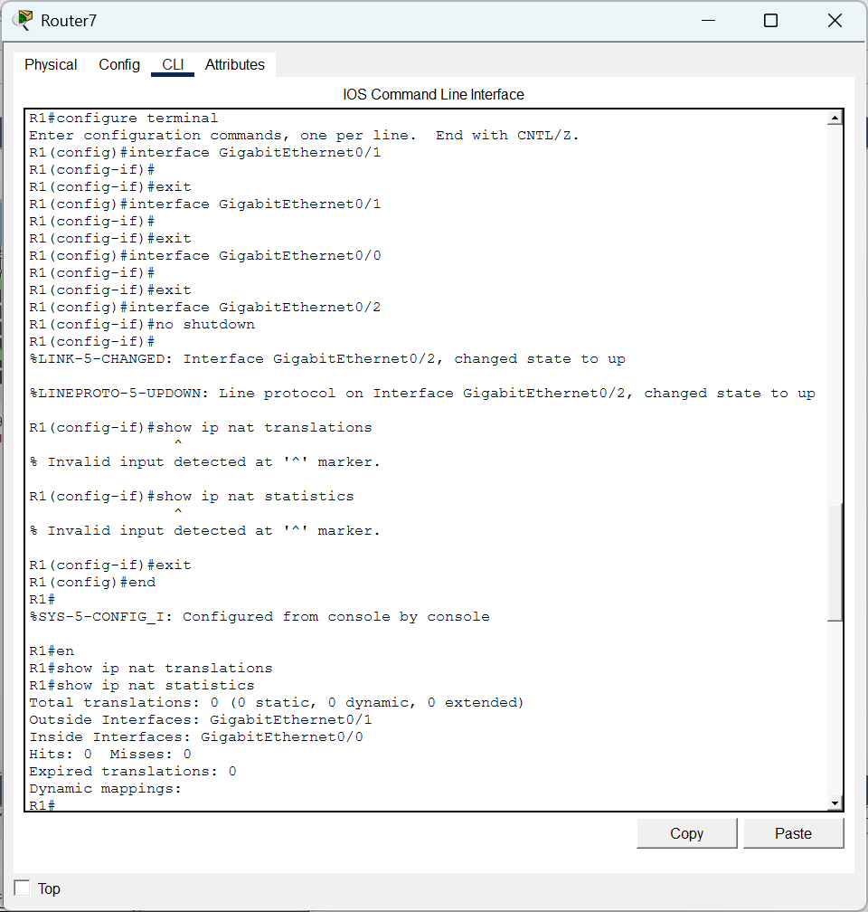
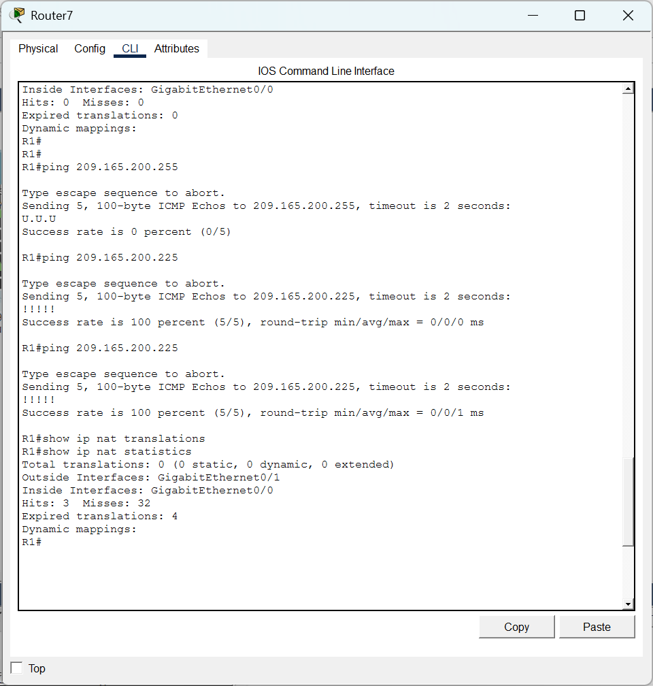
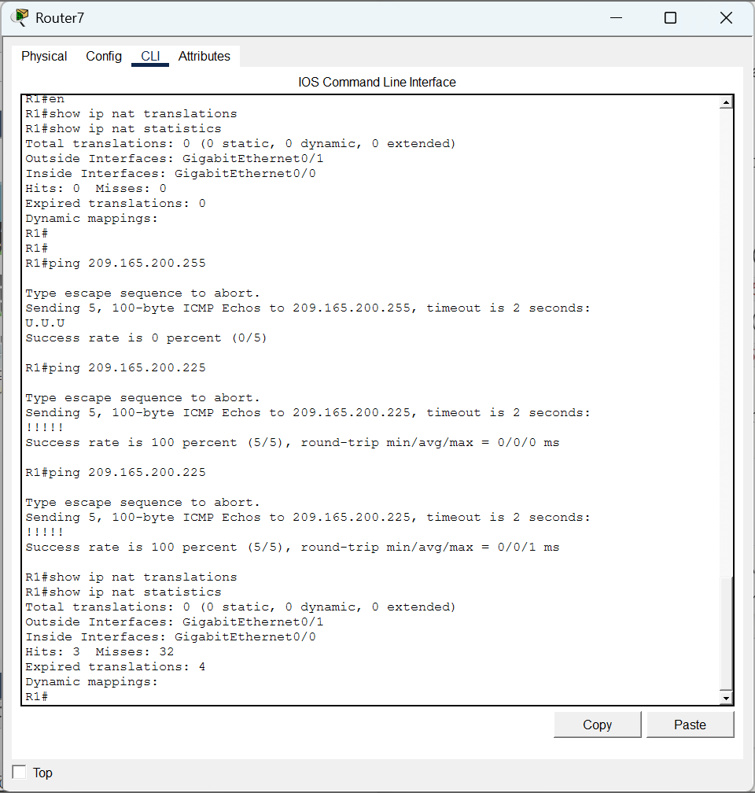
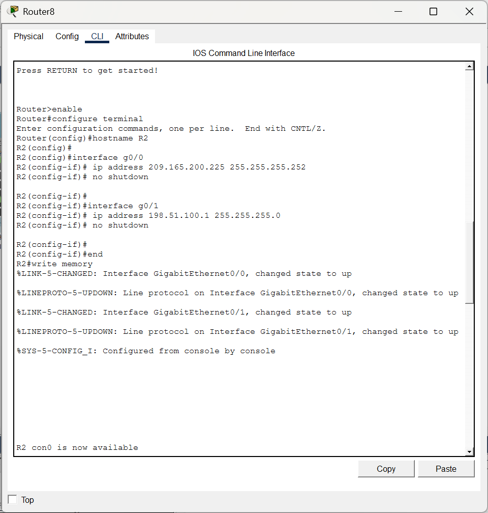
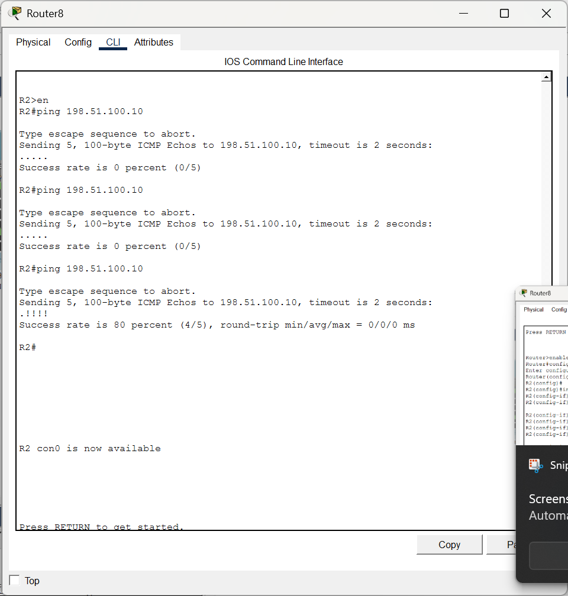
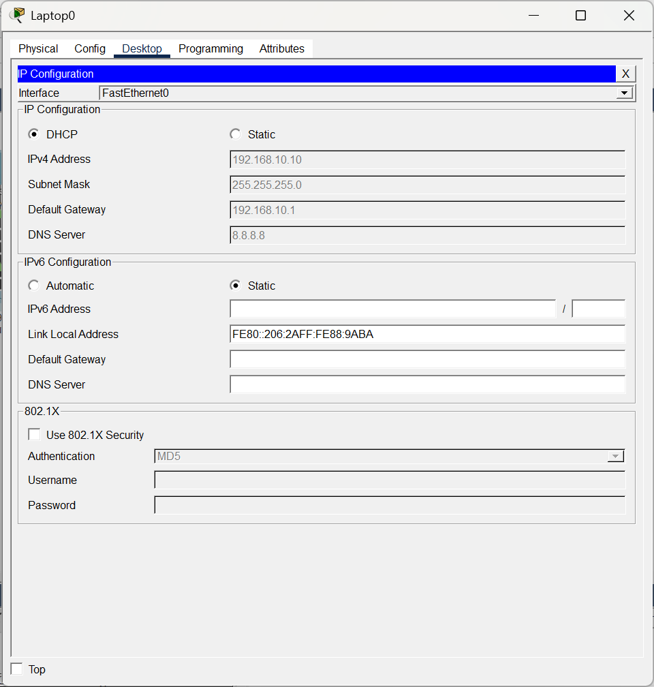
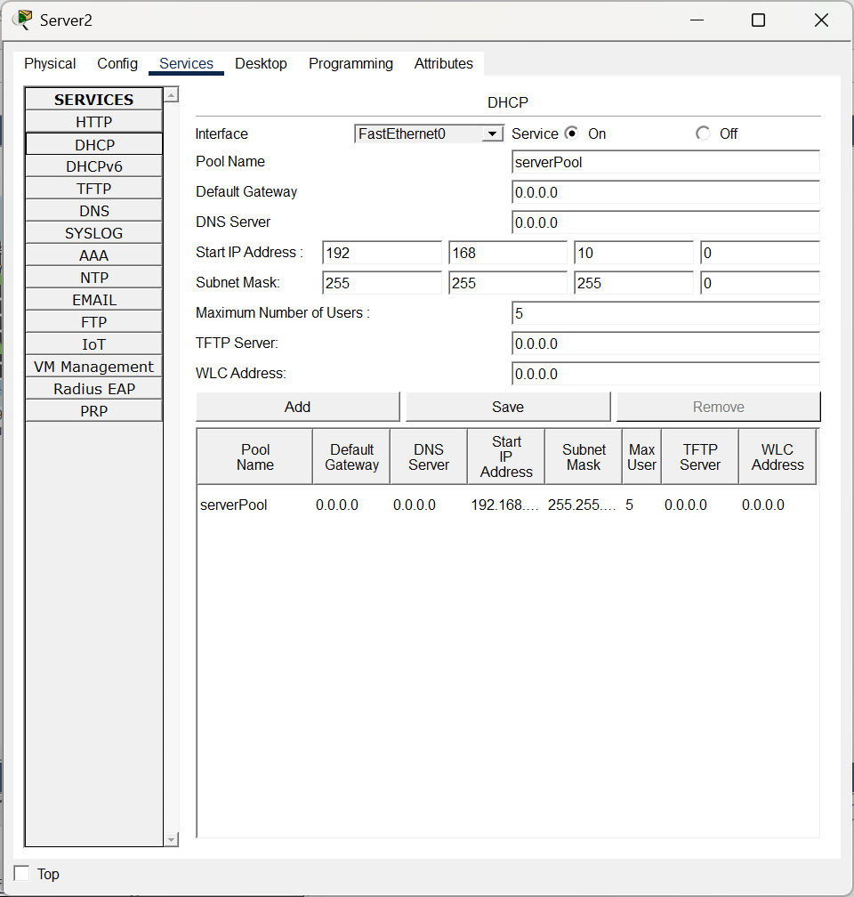

# 06 — NAT/PAT with a DHCP-Served LAN (Two-Router Topology)

**Focus:** Routing, address translation, DHCP  
**Tools:** Cisco Packet Tracer, Cisco IOS

## Objective
Give a private LAN shared outbound access through PAT (NAT overload) behind an ISP-style edge router, with clients addressed by DHCP.

## Topology
Laptops → Switch0 → **R1** (inside `g0/0`, outside `g0/1`) → **R2** (simulated ISP edge, `209.165.200.225/30` toward R1, `198.51.100.1/24` outward). A dedicated DHCP server hangs off R1's third interface.

## What I did
1. Brought up R1's interfaces and set a default route to the ISP: `ip route 0.0.0.0 0.0.0.0 209.165.200.225`.
2. Configured a router DHCP pool (`LAN-POOL`, `192.168.10.0/24`, gateway `192.168.10.1`, DNS `8.8.8.8`) with `192.168.10.1–.9` excluded.
3. Defined the translation scope with `access-list 1 permit 192.168.10.0 0.0.0.255`.
4. Marked NAT roles (`ip nat inside` on g0/0, `ip nat outside` on g0/1) and enabled PAT: `ip nat inside source list 1 interface g0/1 overload`.
5. Configured R2's interfaces.
6. Verified: NAT statistics before traffic (0 hits), pings across the WAN link (a broadcast-range target failed as expected, the ISP router answered 5/5), and statistics afterwards (hits, misses and expired translations recorded).
7. Confirmed a laptop took a DHCP address (192.168.10.10) and reviewed the DHCP server service configuration.

## Observations
- Several pings from R2 to `198.51.100.10` failed before one succeeded 4/5, which looks like ARP/device-readiness delay; I did not isolate the cause.
- Evidence here is router-to-router connectivity and NAT counters; a client-to-server end-to-end test across the NAT boundary is not captured.

## Evidence
**01. Two-router topology with LAN, DHCP server and simulated ISP side**  

**02. R1: default route, DHCP pool, ACL 1, nat inside/outside, PAT overload**  

**03. Interface bring-up and NAT statistics before traffic (0 hits)**  

**04. Pings across the WAN link; NAT statistics afterwards**  

**05. Second verification run of NAT translations/statistics**  

**06. R2 (simulated ISP edge) interface configuration**  

**07. R2 connectivity test to 198.51.100.10**  

**08. Laptop0 receiving 192.168.10.10 via DHCP**  

**09. DHCP server service configuration on Server2**  

