# 07 — Suricata IDS Deployment, Troubleshooting & Traffic Validation

**Focus:** Network IDS, service troubleshooting, detection engineering basics  
**Tools:** Suricata 8.0.6, journalctl/systemd, tcpdump, jq, Nmap, hping3, Ubuntu (sensor), Kali (traffic source)

## Objective
Get Suricata running as a network IDS next to the NGINX/Fail2Ban host from project 01, fix what was broken, and generate realistic traffic to exercise the sensor.

## What I did
1. Read `journalctl -u suricata` across several days and found real failures: `unix-manager` could not create `/var/run/suricata/` (permission denied), repeated `status=1/FAILURE` exits, and **custom-rule parse errors** in `local.rules` (`Signature missing required value "sid"`, `no rule options`).
2. Checked the capture setup in `suricata.yaml` (`af-packet`, interface `enp0s8`) and the `rule-files` / `default-rule-path` settings.
3. Backed up `local.rules` before editing, then fixed the rules.
4. Confirmed the engine was healthy through `eve.json` stats (no capture errors, no drops), inspected with `tail` and `jq`.
5. Used `tcpdump` on the sensor interface as an independent view of the wire.
6. Generated test traffic from Kali: plain `curl` requests, Nmap scans (`-Pn -p 80 --max-retries 0 --min-rate 50`), a bash `/dev/tcp` connect loop and an `hping3` SYN flood.
7. Ran a Fail2Ban jail (`suricata-nmap`) next to the NGINX jails, so detection and response layers were tested together.

## Results
Suricata was taken from a repeatedly failing service to a stable, packet-capturing sensor, and exercised with several traffic-generation methods. **Alert-driven detection and automated response are demonstrated in project 08.**

## Evidence
**01. journalctl history: socket permission errors, service failures and rule parse errors**  
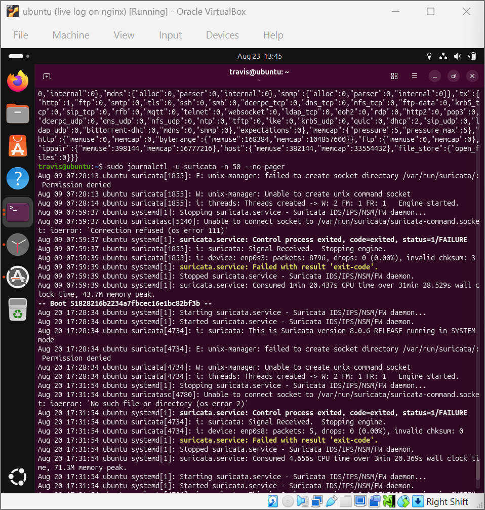

**02. af-packet capture configuration in suricata.yaml**  
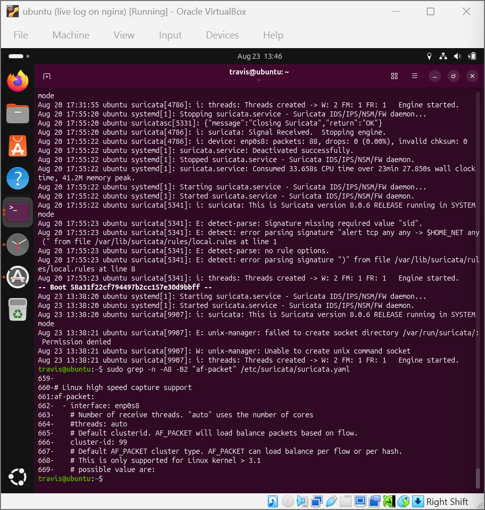

**03. rule-files and default-rule-path in suricata.yaml; local.rules backed up before editing**  
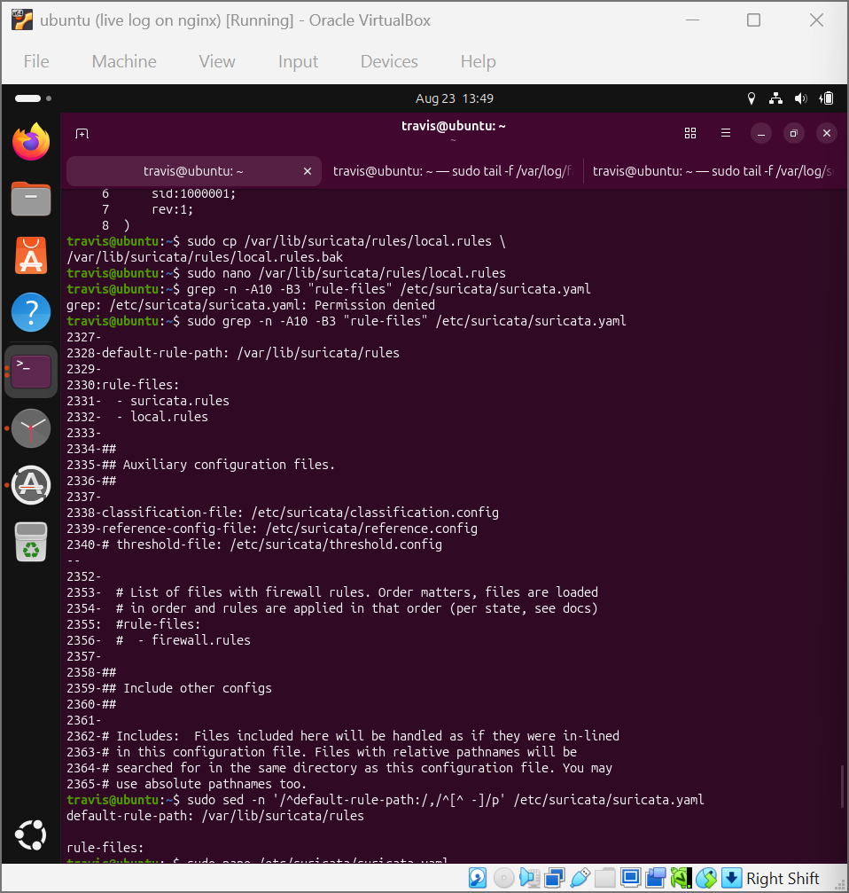

**04. Live tail of eve.json (stats events)**  
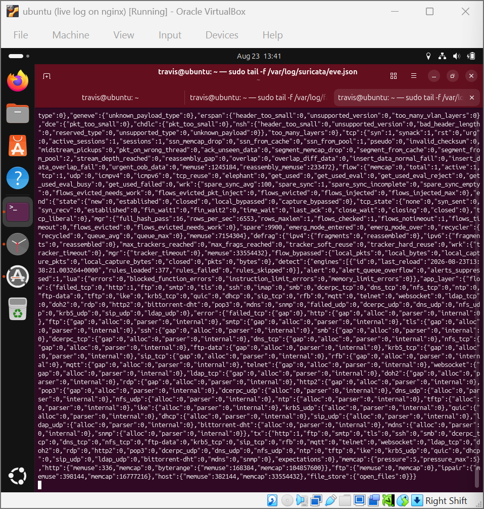

**05. eve.json inspected with jq**  
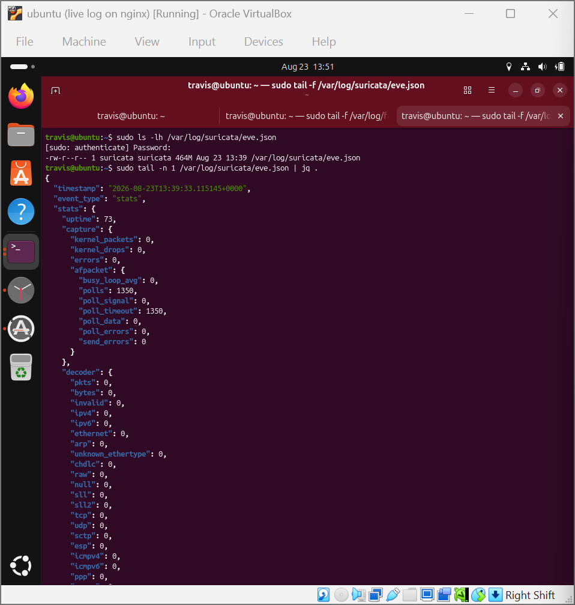

**06. eve.json decoder/stats detail**  
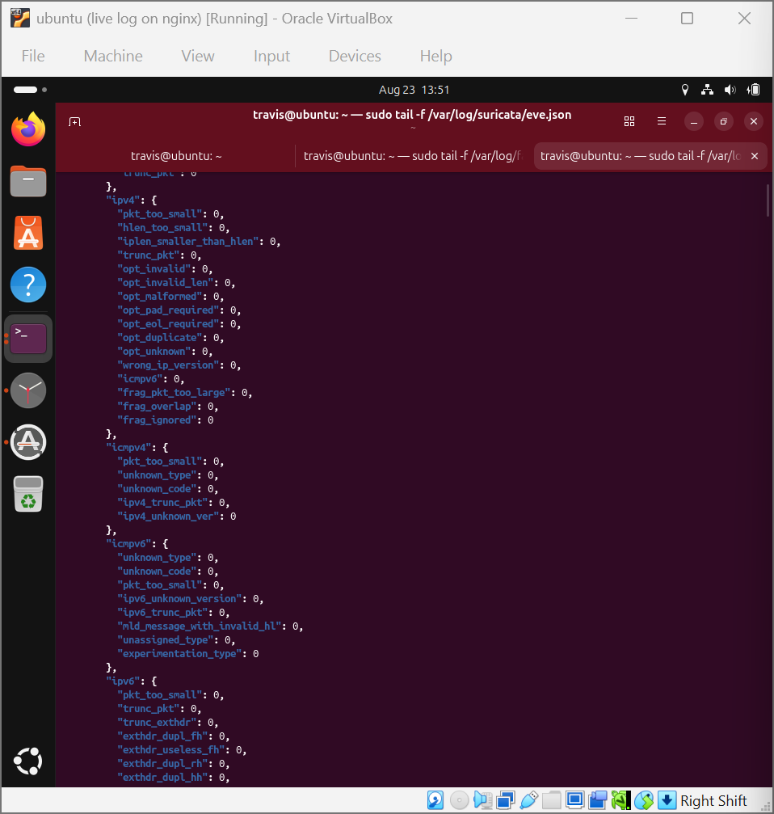

**07. tcpdump on the sensor interface as an independent view of traffic**  
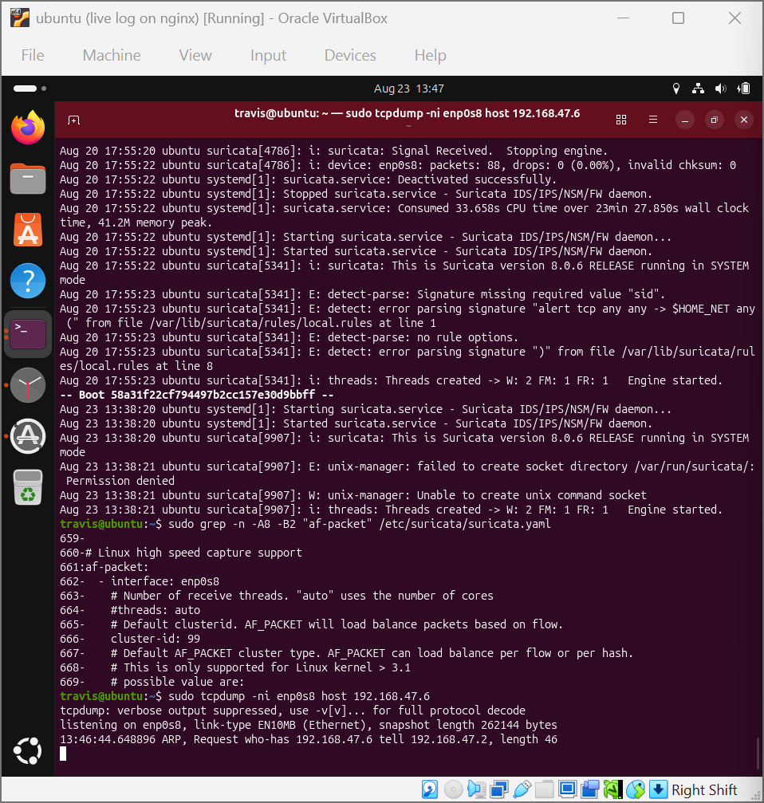

**08. tcpdump showing a full HTTP GET / 200 OK exchange**  
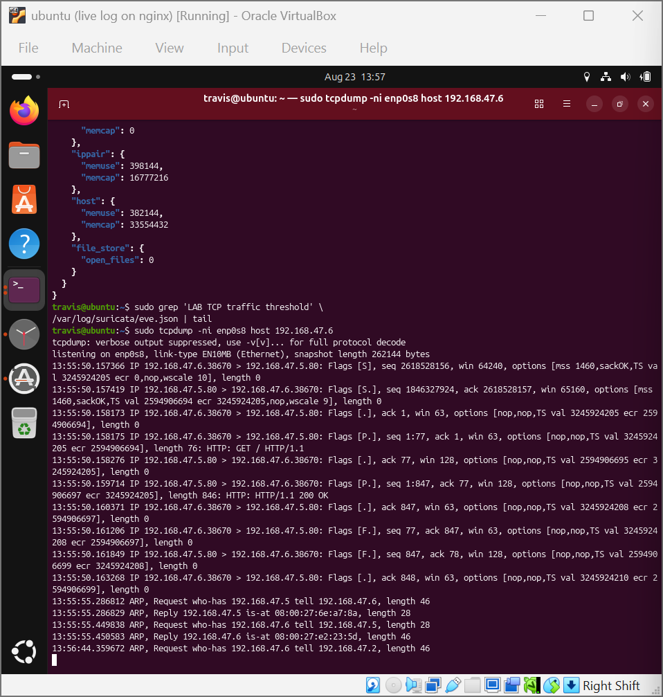

**09. Attacker-side curl to the monitored web server**  
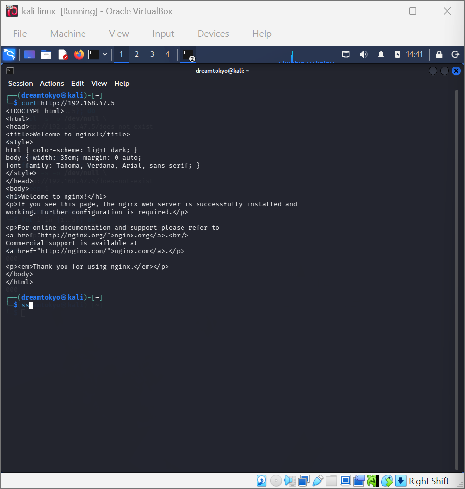

**10. Repeat requests used to generate traffic**  
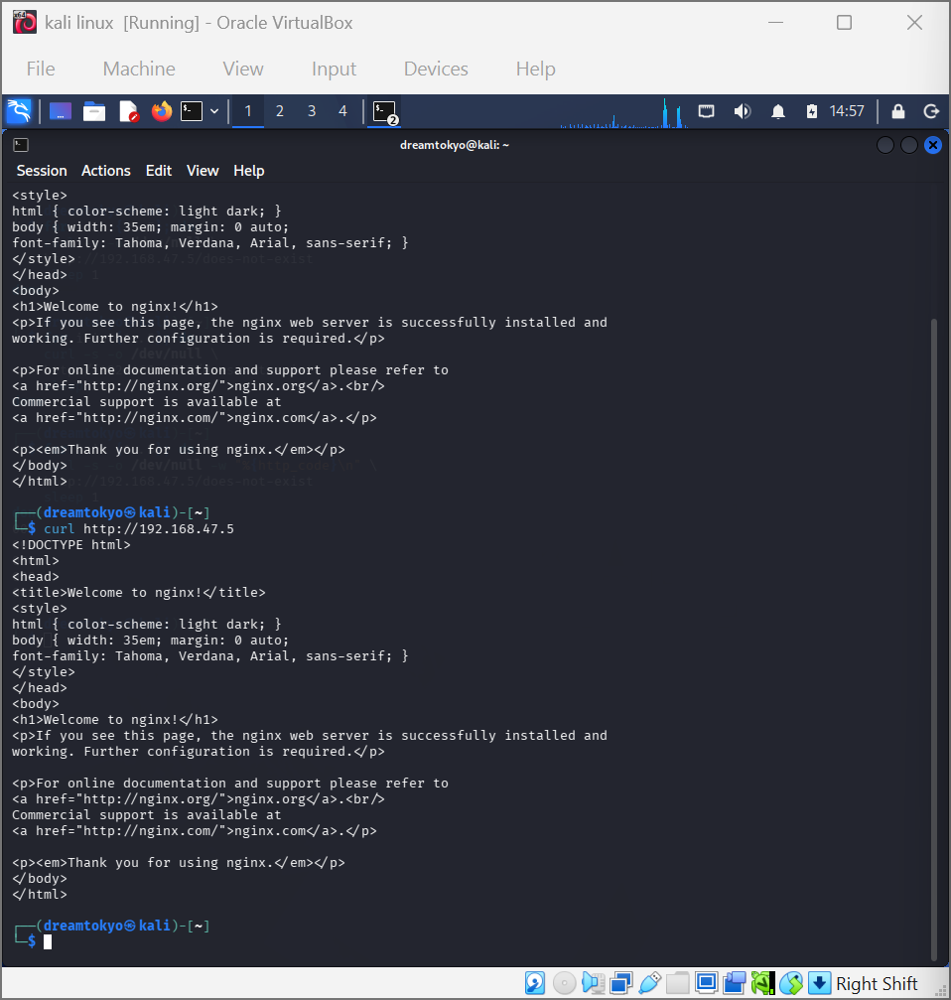

**11. Nmap scans, a /dev/tcp connect loop and an hping3 SYN flood used to generate test traffic**  
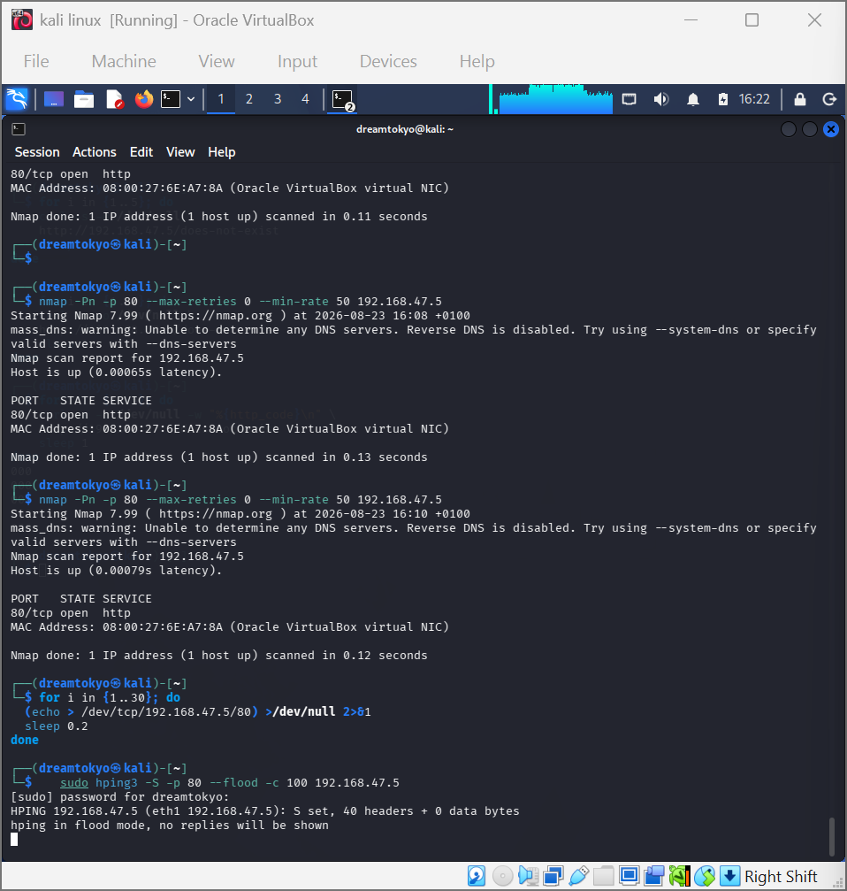
