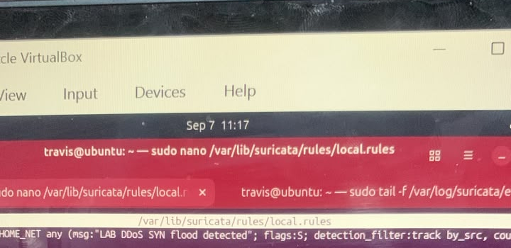
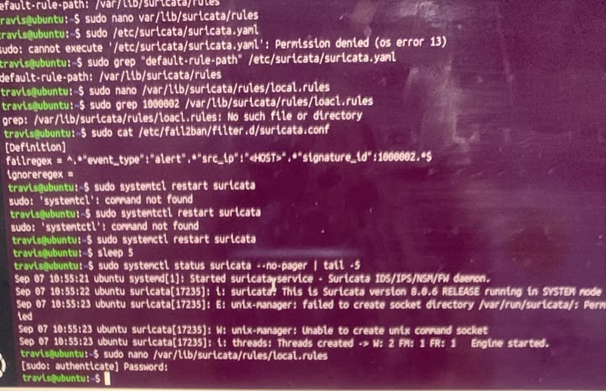
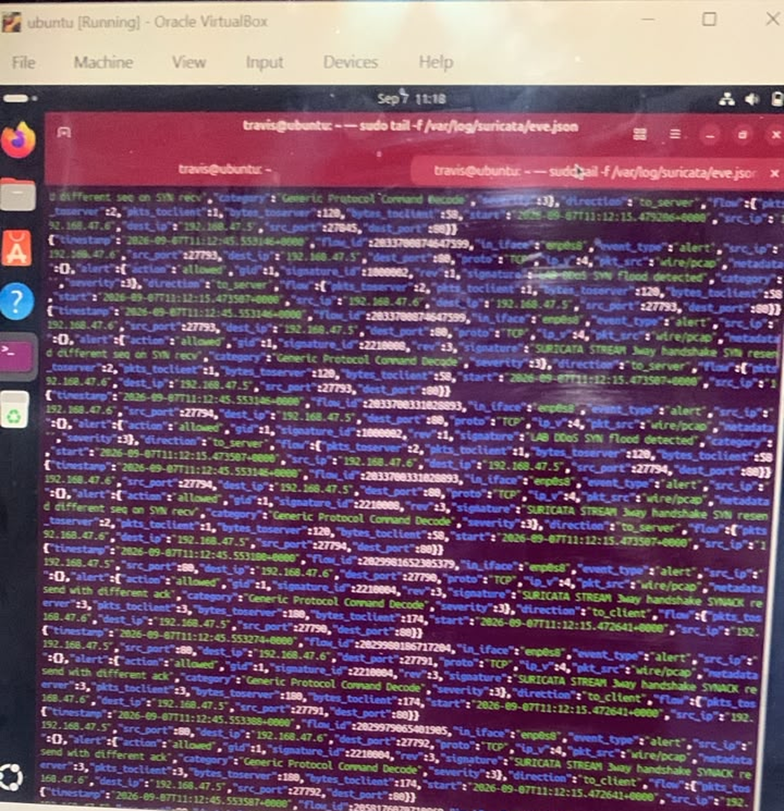
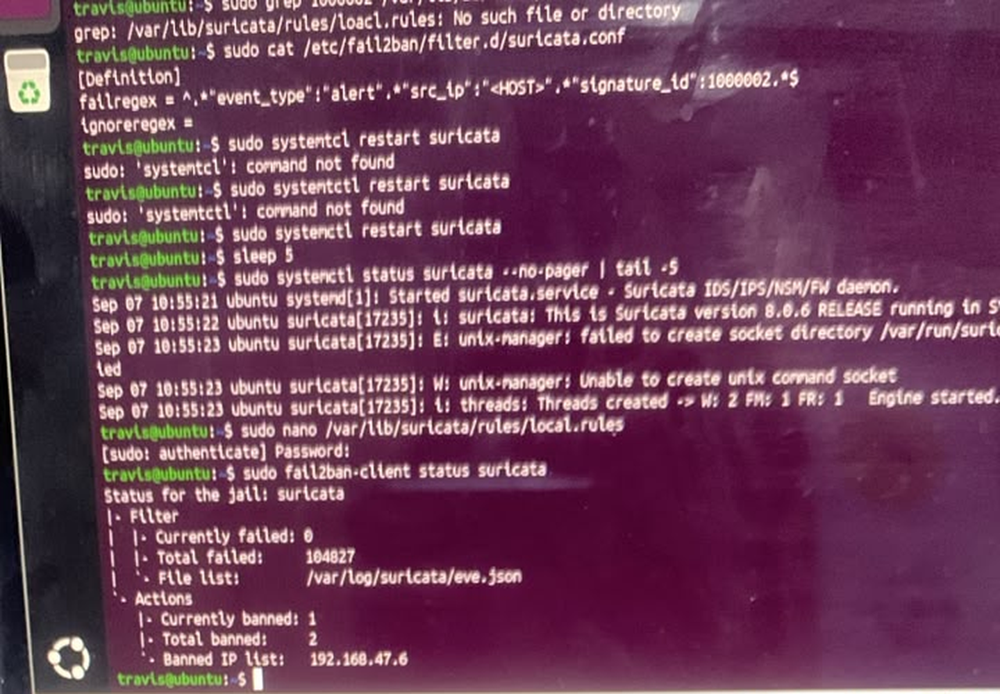
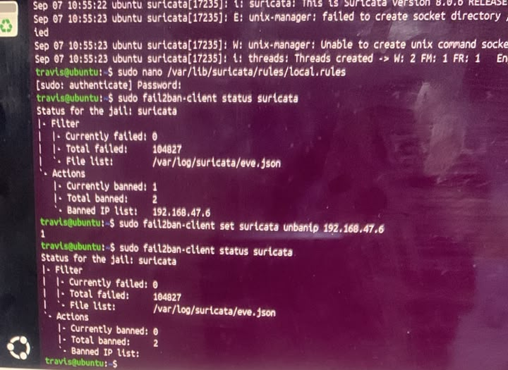

# 08 — SSH & DDoS Protection: Suricata + Fail2Ban + UFW (Hackathon Project)

**Focus:** Layered detection and automated response  
**Tools:** Suricata 8.0.6 (IDS mode), Fail2Ban, UFW, journald, Ubuntu (protected host), Kali Linux (attacker), VirtualBox

## Objective
Protect a Linux host from SSH brute-force and flood attacks by combining network-level detection (Suricata) with automated, firewall-level response (Fail2Ban → UFW).

## Architecture
```
Kali (attacker) ──SYN flood──▶ Ubuntu host (NGINX / SSH)
                                   │
                         Suricata (custom rule, sid 1000002)
                                   │  alert events
                          /var/log/suricata/eve.json
                                   │  parsed by custom Fail2Ban filter
                          Fail2Ban jail "suricata"
                                   │  ban action
                              UFW firewall rule
```

## What was built
- **Suricata:** custom detection rules for a **TCP SYN flood** and an **ICMP flood**. The SYN-flood rule (`LAB DDoS SYN flood detected`, `flags:S`, `detection_filter: track by_src`, **sid 1000002**) counts SYNs per source address and alerts once a threshold is exceeded.
- **Suricata → Fail2Ban bridge:** a custom Fail2Ban filter (`/etc/fail2ban/filter.d/suricata.conf`) that matches Suricata alert events for signature 1000002 in `eve.json` and extracts the attacker's `src_ip`. A jail named `suricata` watches `/var/log/suricata/eve.json` and bans that source.
- **SSH protection:** a Fail2Ban SSH jail that bans after **3 failed attempts within 60 seconds**, reading from **journald**.
- **Debugging:** found and fixed a Fail2Ban/UFW integration bug caused by `banaction` vs `action` configuration.
- **Operations:** added Suricata log rotation so sensor logs do not grow unbounded.
- **Delivery:** presented live as a two-person demonstration.

## Demonstrated in the screenshots below
1. The custom SYN-flood rule is loaded from `/var/lib/suricata/rules/local.rules`.
2. The Fail2Ban filter regex keys on `"event_type":"alert"`, the alert's `src_ip` and `"signature_id":1000002`.
3. During the flood, `eve.json` fills with `LAB DDoS SYN flood detected` alerts (signature 1000002) from `192.168.47.6` to `192.168.47.5:80`, alongside Suricata's built-in stream alerts (`SURICATA STREAM 3way handshake SYN resend different seq on SYN recv`, `SYNACK resend with different ack`) caused by the flood.
4. `fail2ban-client status suricata` shows **104,827 matched alerts, 2 total bans, and `192.168.47.6` currently banned**.
5. Ban lifecycle closed with `fail2ban-client set suricata unbanip 192.168.47.6`; the status afterwards shows 0 currently banned.

## Troubleshooting along the way
- Typos (`loacl.rules`, a misspelled `systemctl`) produced "No such file" and "command not found"; corrected.
- Editing `suricata.yaml` without `sudo` returned `Permission denied`.
- Suricata logs `unix-manager: failed to create socket directory /var/run/suricata/` (permission denied) on start. It is non-fatal here: the engine still starts and writes `eve.json`.

## Observations and what I would improve
- Suricata ran in **IDS mode**, so the alerts show `"action":"allowed"`. Blocking happens in Fail2Ban/UFW, one step after detection.
- Fail2Ban counted 104,827 matches because every flood packet above the threshold produced an alert line. In production I would rate-limit alerts (a `threshold` or longer `detection_filter` window) and tune the Fail2Ban `maxretry`/`findtime` so a ban triggers quickly without scanning six-figure log volumes.
- Source-based banning does not stop a distributed attack; upstream rate limiting or a provider-side DDoS service would be needed.

## Evidence
**01. Custom SYN-flood rule open in `local.rules`**  


**02. Fail2Ban filter `suricata.conf`, Suricata restart and service status**  


**03. Live `eve.json` alerts during the SYN flood**  


**04. `suricata` jail status: attacker banned**  


**05. Manual unban and jail status afterwards**  


## Still to add
Not yet shown in screenshots: the ICMP-flood rule text, the SSH jail with a real brute-force attempt, the `banaction` fix (before/after) and the logrotate configuration. Add them under `screenshots/` and list them above.
